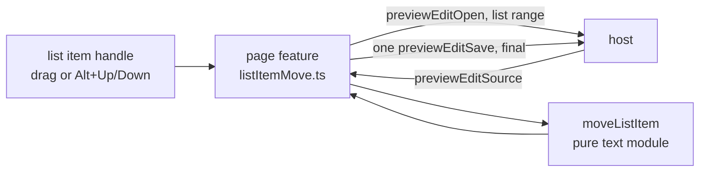

## Summary

In edit mode, the rows of a table can be reordered with a handle on their left, but the items of a
list could not: the only way to reorder them was to cut and paste their Markdown. Each list item
now gets the same handle as a table row. Dragging it among the item's sibling items, or pressing
Alt+Up or Alt+Down on the focused handle, moves the item with its sub-items and blocks, as one
edit that one undo reverts. An ordered list keeps its numbers in order. This works in every list,
including the lists inside GitHub alerts, quotes and MyST admonitions, whose handles sit left of
the outermost box.

## Deliverables



The pure module that moves an item on the list's own source text:

```ts
// src/page/modules/listItemMove.ts
export function moveListItem(
  source: string, itemCount: number, from: number, to: number,
): string | undefined; // undefined: the source does not read as the rendered items
```

- The item moves with its sub-items, fenced blocks and inner blank lines; the blank lines between
  items stay in place, so a tight list stays tight and a loose list stays loose.
- An ordered list is renumbered from its first number (`3.` `4.` `5.`); a list written all `1.`
  stays all `1.`. When a marker grows (`9.` to `10.`), the item's continuation lines are indented
  so its content stays inside it.
- Inside a quote or an alert, the `> ` prefix is stripped, then written back on every line, byte
  for byte. Only the list's own lines are opened and saved, never the container's.

## Changes

- `src/page/modules/listItemMove.ts` (new): the text move, with its refusals (a count that differs
  from the rendered items, text before the first item, less indentation, mixed quote prefixes).
- `src/page/modules/tableInContainer.ts`: the quote-prefix reader is exported and shared.
- `src/page/features/mappedBlocks.ts`: `listRange(list)` exposes the source range of a list.
- `src/page/features/listItemMove.ts` (new): the handles layer, placement (left of the list, or of
  the outermost container), the push of a block with no room on its left, drag and drop among
  siblings, Alt+Up/Down, the move request and the busy states. Wired like the table row handles in
  `runtime.ts`, `pageRuntime.ts`, `editMode.ts`, `blockSourceEditor.ts` and `pageInput.ts`.
- `src/core/preview/styles/editModeStyles.ts`: the list item handle styles, scoped to edit mode.
- Requirements: a new SwRS, SwRS-MDOKFSTUDIO-BLOCK-262, derived from StRS-MDOKFSTUDIO-BLOCK-014,
  which gains a "Move a list item" main path.
- `docs/user/editing.md`, the glossary and the changelog.

## Impacts

Writers see a six-dot handle left of each list item in edit mode, as on table rows. Nothing changes
in reading mode, and the table handles do not change. A click on an item still edits it as before;
the handle only moves it. Cmd/Ctrl+Alt+Up/Down in a list item editor still moves the whole list.

Before at `cdf286f` (main), after at `cb618b1`, from the visual job of CI:

| Before | After |
| --- | --- |
|  |  |
|  |  |

After only, on a new test page (bullet, ordered, nested, task lists, and lists in a GitHub alert and
in nested admonitions, whose handles sit left of the outermost box):

| Light | Dark |
| --- | --- |
|  |  |
|  |  |

In a narrow 360 px pane, the blocks are pushed right so every handle stays inside the pane:


## Blast radius

Grade: 2

The feature is new and isolated in its own module and feature, but it adds a layer and a push rule
in edit mode next to the table handles, and touches the shared click and source routing of the
page. A plain `git revert` removes it.

## Test plan

- [x] New or changed tests (they fail on the previous code): `listItemMove.test.ts` (text module),
      `runtimeListItemMove.test.ts` (page feature), `listItemRange.test.ts` (list ranges with the
      real renderer, in quotes, alerts and admonitions), `listItemHandleStyles.test.ts` (shipped
      styles), visual scenarios and a real-window scenario
- [x] Requirements: SwRS-MDOKFSTUDIO-BLOCK-262 added, StRS-MDOKFSTUDIO-BLOCK-014 amended, markers in
      code and tests, `just requirements-update`
- [x] Changelog: one user-facing line under `## Unreleased` in `CHANGELOG.md`
- [x] Local gates at `cb618b1`: `just check` (4138 tests, 0 fail; site 101, 0 fail),
      `just requirements-lint` (0 changes, 581 main path citations valid), `just check-markers`
      (406 in-force SwRS marked); `just preflight` at `cb618b1` (carried from `e788cff`: the
      rebase onto main left the patch unchanged)
- [x] Review: approved at `cb618b1` (carried from `e788cff`)
- [x] CI green at `cb618b1`: pull request checks, and the full run with the real VS Code jobs
      (visual, integration, stress)

## Autonomous decisions

- Handles are centred on the item's first line, left of the item's own list; inside containers they
  share one column left of the outermost container.
- A move opens and saves the range of the item's own list only.
- No move happens while any block editor is open.

## Known gaps

- A zero-padded ordered list (`01.` `02.`) loses its padding after a move.
- The Alt+Up and Alt+Down keys on macOS were not run: CI has no macOS runner. Their tests ran on Linux and
  Windows.
- No screenshot shows an ordered list before and after a move: the visual drag scenario moves a
  bullet list. The renumbering is proven by the tests and the real-window scenario.
- The new test page has no "before" screenshot: the page is new in this change, so the base has
  no capture of it.

## Internal references

- CR-432 list-item-reorder-handles; follows CR-424 (item-level list editing).
- Screenshots: branch `chantier/batch-06/cr-432-list-items-get-reorder-handles-on-the-le-assets`.
