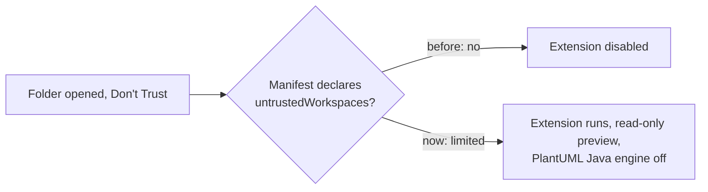

## Summary

VS Code disables an installed extension in Restricted Mode (a folder opened with "Don't Trust")
unless its manifest declares support for untrusted workspaces. The Studio has a full read-only
preview for that mode, and the docs say it works there, but `package.json` declared nothing, so a
packaged build was disabled. The manifest now declares the support.

## Deliverable showcase

```jsonc
// package.json
"capabilities": {
  "untrustedWorkspaces": {
    "supported": "limited",
    "description": "In Restricted Mode the preview is read-only: ...",
    "restrictedConfigurations": [
      "markdownOkfSchemaStudio.plantuml.useJar",
      "markdownOkfSchemaStudio.plantuml.jarPath"
    ]
  }
}
```



## Changes

- `package.json`: `capabilities.untrustedWorkspaces` (limited, with a description and the two
  PlantUML engine settings as restricted configurations).
- Unit test reads the manifest; the Restricted Mode window suite asserts the declaration through
  the installed extension manifest.
- Requirements: the boundary scenario of the read-only preview now states the declaration; the
  "Known issue" lines about a disabled packaged extension are removed.

## Impacts

Users of the installed extension get the read-only preview in Restricted Mode. No visual change.
The behaviour was verified against the VS Code 1.143.1 source (the rule returns false without the
declaration); a packaged VSIX was not run in a real Restricted Mode window.

## Blast radius

Grade: 1. A manifest declaration; a plain `git revert` restores the previous behaviour.

## Test plan

- [x] New or changed tests (the manifest test fails on the previous code)
- [x] Requirements: SwRS updated, `okfreq validate/lint/update-coverage --check` pass (1010 requirements)
- [x] Local gates: `just check` (2593 unit tests, 44 and 26 in the other suites, all passing)
- [ ] Review
- [ ] CI green

## Internal references

- CR 062 restricted-mode-capability

🤖 Generated with [Claude Code](https://claude.com/claude-code)
