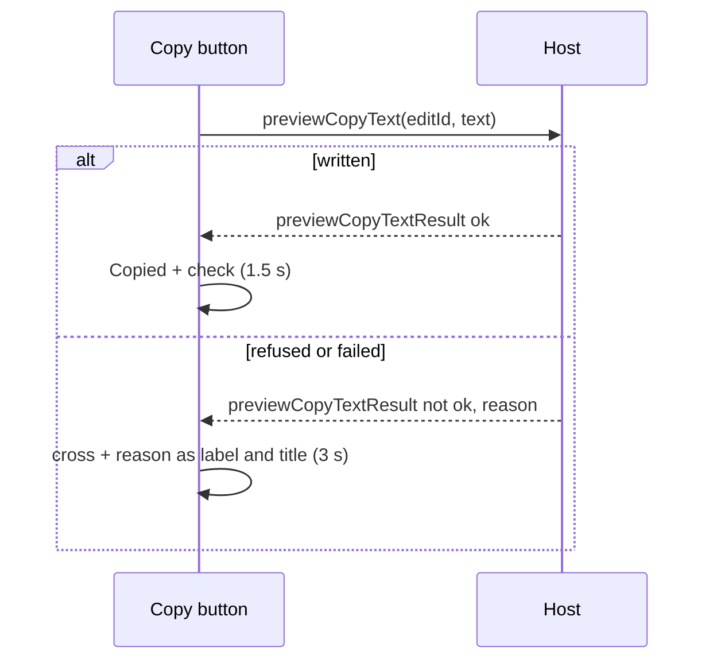

## Summary

The code-block copy button said "Copied" the moment it was clicked, even when nothing reached the
clipboard: the text was over 1 000 000 characters, or the document had changed since the preview
rendered and the host dropped the request. The button now reports what happened.

## Deliverable showcase

| Case | Before | After |
| --- | --- | --- |
| text over 1 000 000 characters | "Copied", clipboard unchanged | cross, "Too large to copy." |
| clipboard write fails | "Copied" | cross, "Could not copy." |
| typed since the preview rendered | "Copied", clipboard unchanged | copied, "Copied" |

## Changes

- The host answers every copy request with `previewCopyTextResult` (matched by the request's edit
  id, like the other host round trips); the page waits for it, ignores answers of older clicks and
  shows the "did not answer" refusal after 6 s.
- The copy request moves from the render gate to the document gate: a copy edits nothing, so only
  the document is checked.
- The shape check accepts up to 20 000 000 characters so the host can answer the size limit.
- Requirements updated (copy button, copy request, gates, host round trips); the Known issue lines
  for this behaviour are removed.

## Impacts

Visible only when a copy fails or is refused. No change to the normal success path.

## Blast radius

Grade: 1. One message type and one button; a plain revert restores the previous behaviour.

## Test plan

- [x] New tests fail on the previous code: page (label follows the answer, older answer ignored),
      host (stale version still copied and answered, size refusal, failing clipboard), validator
- [x] Requirements: SwRS updated, markers in sync, `just requirements-update` clean
- [x] `just check` passes; 2603 unit tests and 44 security tests pass
- [x] Browser visual checks updated to play the host answer: 329 scenarios, 219 screenshots passed
- [ ] Real-window check not run

## Internal references

- Change request 073 (copy-button-false-copied)

🤖 Generated with [Claude Code](https://claude.com/claude-code)
