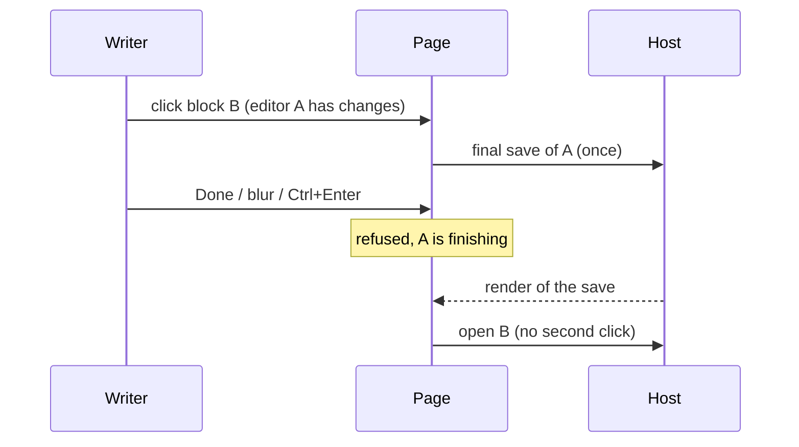

## Summary

In the block editor, clicking another block while the open editor holds changed text saved the
first block but opened nothing, so the writer had to click again after the preview refreshed.
Pressing Done again, Ctrl+Enter or leaving the text box while the final save was in flight posted a
second final save. Both are fixed.

## Deliverable showcase

| | Before | After |
| --- | --- | --- |
| Click on B while A holds changes | A saved, B not opened | A saved, B opens after the render |
| Done again while saving | second final save posted | refused |

## Changes

- `openMappedEditor` remembers the clicked block and saves the open editor; the existing
  post-render navigation opens the block. A click on the editor's own block does nothing.
- `postBlockEditSave` refuses any save, final or not, while the editor is finishing.
- Requirements: removed two "Known issue" lines, added the new behaviour as scenarios.

## Impacts

No visual change. Editing across blocks needs one click instead of two.

## Blast radius

Grade: 1

Local to the page-side block editor; a plain `git revert` restores the previous behaviour.

## Test plan

- [x] New or changed tests (they fail on the previous code): 2 new page tests, both fail on the previous code
- [x] Requirements: two SwRS updated, markers in code and tests, coverage regenerated
- [x] Local gates: `just check` (1011 requirements, 0 errors; 31 Python tests), page unit tests 696/696
- [ ] Review
- [ ] CI green

## Internal references

CR 078 (block-editor-save-races); SwRS BLOCK-041, BLOCK-047.

🤖 Generated with [Claude Code](https://claude.com/claude-code)
