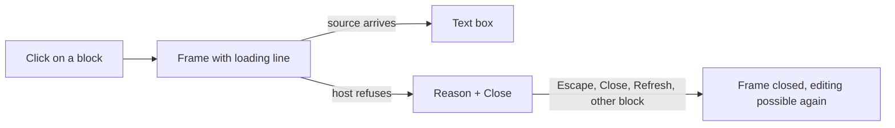

## Summary

When the Studio refused to open a block editor or a table cell editor (stale preview, another
block already open, untrusted workspace), the writer saw an empty frame with no reason and no way
out: no button, no Escape, Refresh stayed disabled and a click on another block did nothing until
a render arrived. A block move refused after a key press also gave no reason. Now the reason is
always visible and the writer can leave.

## Deliverable showcase

```text
Before: click block -> empty frame (no text, no reason) -> stuck
After:  click block -> frame "Loading Markdown source…"
                    -> refused: frame "The preview is out of date. Try again…"  [Close]
                       Escape | Close | Refresh | click another block -> frame closes
```



Keyboard move: Alt+Down refused by the host now prints the reason next to the bar under the
block (or under the last selected block), like an arrow click does.

## Changes

- The status line is added to the editor frame when it is created, so "Loading Markdown source…"
  and then the refusal reason are visible.
- A refused open marks the editor as refused: it adds a Close button, re-enables Refresh and
  closes on Escape, Close, Refresh or a click on another block (no cancel is posted, the host
  holds nothing).
- A refused keyboard move shows its reason on the bar of the moved block or selection.
- Requirements updated; the Known issue lines about this behaviour are removed.

## Impacts

Visible: a refused open shows its reason and a Close button. The button sits in the same button
row as Done and Cancel, so it uses their existing style (no new CSS); no screenshots were taken.

## Blast radius

Grade: 1. Local to the block editor open path and the move result handler; a plain `git revert`
restores the previous behaviour.

## Test plan

- [x] New or changed tests (they fail on the previous code): 7 tests fail on the previous code; 5 page tests changed or added
      (loading line in the frame, Close, Escape, another block, Refresh, key-move reason for a
      block and a selection, table cell Close); 1 startup trace updated for the new frame child.
      Two existing assertions changed, intent kept: the refused-open table cell region now has
      2 children (reason + Close row) instead of 1, still checking the reason replaces the
      loading text; the keyboard-move timer check is `<=` instead of `<` plus "0 timers left
      after 6 s", because the refusal reason now has its own 6 s timer replacing the flight
      timer, still checking the flight timer is cleared by the answer
- [x] Requirements: SwRS-MDOKFSTUDIO-BLOCK-216, 033, 130, 156, TABLE-034, TRUST-065 and
      StRS-MDOKFSTUDIO-BLOCK-025 updated, `just requirements-update` run (validate: 1011
      requirements, 0 errors; lint and coverage `--check` clean)
- [x] Local gates: `just check` (2620 unit, 44 security, 2 contract tests pass)
- [ ] Review
- [ ] CI green

## Internal references

- CR 080 (refused-open-empty-frame)

🤖 Generated with [Claude Code](https://claude.com/claude-code)
