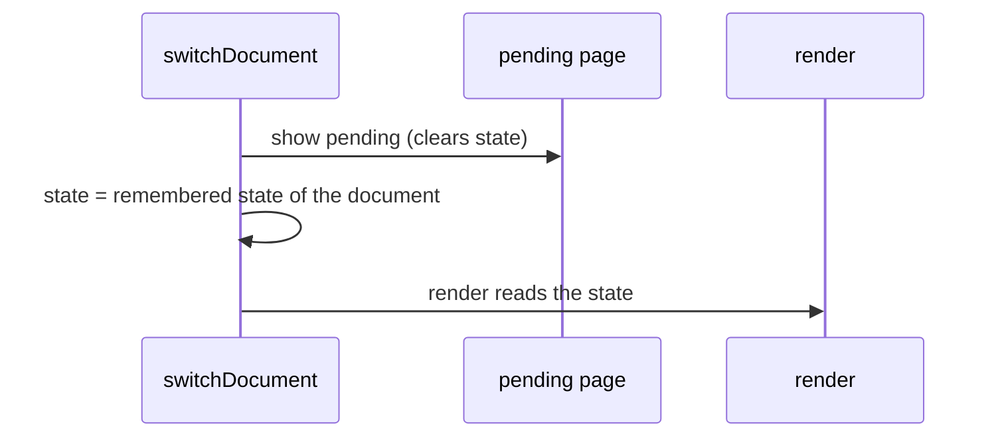

## Summary

Switching a preview from document A to B and back to A lost the focused block, the selection, the
open sections and the Description choice of A. The preview remembered them, but the pending page
shown during the switch cleared the state before the render of A could read it.

## Deliverable showcase

Before: A (line 80, block 3 focused, section 1 open) -> B -> A renders with none of it.
After: the same sequence renders A with the focused block and open sections back.

## Changes

- `previewManager.switchDocument` restores the remembered state after the pending page is shown.
- The session test A -> B -> A now asserts the state comes back (it asserted the loss before).
- Requirements: the two Known issue lines of the reading-state requirement and the one of the
  stakeholder requirement are removed, the switching scenario states the new behaviour.

## Impacts

No visual change; returning to a document in the same preview keeps its reading state.

## Blast radius

Grade: 1. One line moved in the document switch; `git revert` restores the previous behaviour.

## Test plan

- [x] New or changed tests (the A -> B -> A test fails on the previous code)
- [x] Requirements: SwRS updated, markers in sync, `okfreq validate/lint/update-coverage` clean (1011 requirements)
- [x] Local gates: `just check` (2620 unit tests passed, 0 failed)
- [ ] Review
- [ ] CI green

## Internal references

CR 081 (switch-back-state-lost).

🤖 Generated with [Claude Code](https://claude.com/claude-code)
