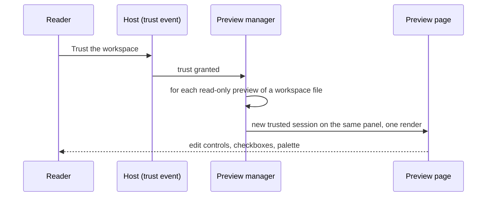

## Summary

A preview opened in VS Code Restricted Mode stayed read-only after the reader trusted the
workspace: it only became editable after switching document or reopening the panel. Trusting the
workspace now upgrades every open preview in place.

## Deliverable showcase

| | Before | After |
| --- | --- | --- |
| Open preview after "Trust" | read-only until reopened | editable, re-rendered once |
| Resource and navigation roots | the document folder | the workspace folders |
| Reading state (scroll, open sections) | n/a | kept |

## Changes

- `PreviewManager.refreshTrust()` replaces a read-only session whose document is now in a trusted
  workspace folder by a new session on the same panel (shared `replaceSession` with the document
  switch), passing the current reading state; `HostEvents.onTrustGranted` calls it.
- Previews that stay read-only (file outside every workspace folder) are untouched.
- Requirement TRUST-001: the trust-granted scenario states the new behaviour; its Known issue is
  removed; update log entry added.

## Impacts

No visual change other than the editing controls appearing once trust is granted.

## Blast radius

Grade: 2. Security-relevant: the trusted session widens resource roots, CSP and navigation roots and enables writes, and `replaceSession` is shared with the document switch path. A revert restores the old behaviour; the active preview is kept active after the replacement (tested).
behaviour.

## Test plan

- [x] New or changed tests (they fail on the previous code): the host-level test "granting trust
      turns an open Restricted Mode preview into a writable one" replaces the test that asserted
      the old read-only behaviour (its intent is reversed because the behaviour is the fix)
- [x] Requirements: SwRS-MDOKFSTUDIO-TRUST-001 updated, markers in sync, okfreq validate, lint
      and update-coverage clean (1011 requirements, 0 errors)
- [x] Local gates: `just check` green (2620 unit, 2 contract, 44 security tests)
- [ ] Review
- [ ] CI green

The test runs in the in-memory host (fake `vscode`), not in a real Restricted Mode window; no
window suite was run for this change.

## Internal references

- CR 082 (trust-grant-refresh); former SwRS-MDOKFSTUDIO-LIFE-155 merged into TRUST-001.

🤖 Generated with [Claude Code](https://claude.com/claude-code)
