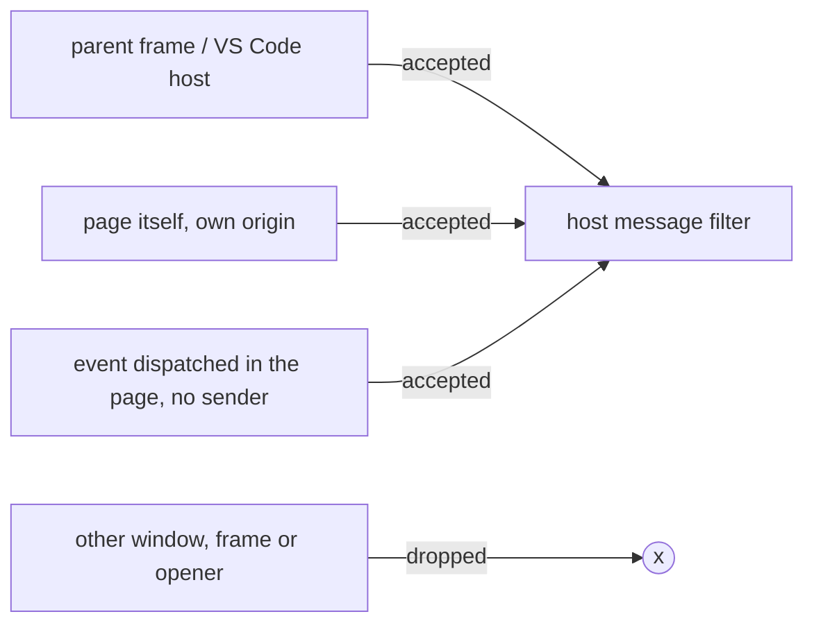

## Summary

The preview page trusted more than it needed to. Its HTML sanitizer was a deny-list (any element or
attribute it had no rule for passed through), the page accepted window messages from any sender, and
a linked stylesheet reported as "ignored" was still left in the page. This change tightens all
three without changing what the preview renders.

## Deliverable showcase

Sanitizer, before and after (`<base>`, a non-stylesheet `<link>`, unknown elements and attributes):

```text
<base href="https://x/"> <link rel="icon"> <p data-example="1" class="a" aria-label="b">
before: all kept
after : <p class="a" aria-label="b">   (blocked-element / blocked-attribute recorded)
```

Which window messages reach the page:



## Changes

- `src/core/security/html-sanitizer.ts`: allow-list of elements (HTML, basic SVG and MathML) and
  attributes (global, per-feature, `aria-*`, and the `data-*` the renderer writes); anything else is
  removed with the diagnostics `blocked-element` and `blocked-attribute`. Every `<link>` is removed;
  an ignored stylesheet keeps its "ignored" diagnostic.
- `src/page/hostTransport.ts`: `isTrustedMessageSender` filters window message events by sender
  (parent frame, own window with own origin, or no sender). The sender frame is checked rather than the
  origin string, because the host origin differs between VS Code versions.
- Requirements: the three "Known issue" lines (sanitizer deny-list, message origin, stylesheet link)
  are removed and the scenarios state the new behaviour. The VS Code-supplied CSP wildcard note stays.

## Impacts

No visual change: the rendering fixtures (MyST/Sphinx output, Mermaid and PlantUML, KaTeX, admonitions,
tables, images, raw HTML tables and colour spans) produce the same pages and screenshots. Raw HTML with
exotic elements or unknown attributes now loses them.

## Blast radius

Grade: **3**. The sanitizer sits on every rendered page and the transport carries every host message;
an allow-list that misses a needed element or attribute silently drops it, and a wrong sender check
would silence the host. Covered by the visual suite, plus one real-window run (the heavy CI job) still to do before merge; rollback is
a `git revert` of this commit.

## Test plan

- [x] New or changed tests (they fail on the previous code): sanitizer allow-list, removed link element
      and diagnostics, sender filter of the transport; one assertion changed (the ignored stylesheet link
      is no longer kept in the page, by intent of this change)
- [x] Requirements: the three sanitizer and transport requirements updated, markers in code and tests,
      `okfreq update-coverage` and `lint` clean
- [x] Local gates: `just check` (unit 2622, security 46, contracts 2, requirements 1011 with 0 errors),
      `just ci-visual` (332 scenarios, 222 screenshots, all passed), the real VS Code window suite could not run (the macOS session was
      locked); the sender check cannot be proven without a real webview, so it needs one run of the
      integration job (`gh workflow run ci.yml -f heavy=true`) before merge
- [ ] Review
- [ ] CI green

## Internal references

- Change request 083 (page-security-hardening); SwRS TRUST-036, TRUST-042, TRUST-059.
- TRUST-012 (VS Code CSP wildcard) is not ours and stays a note.

🤖 Generated with [Claude Code](https://claude.com/claude-code)
