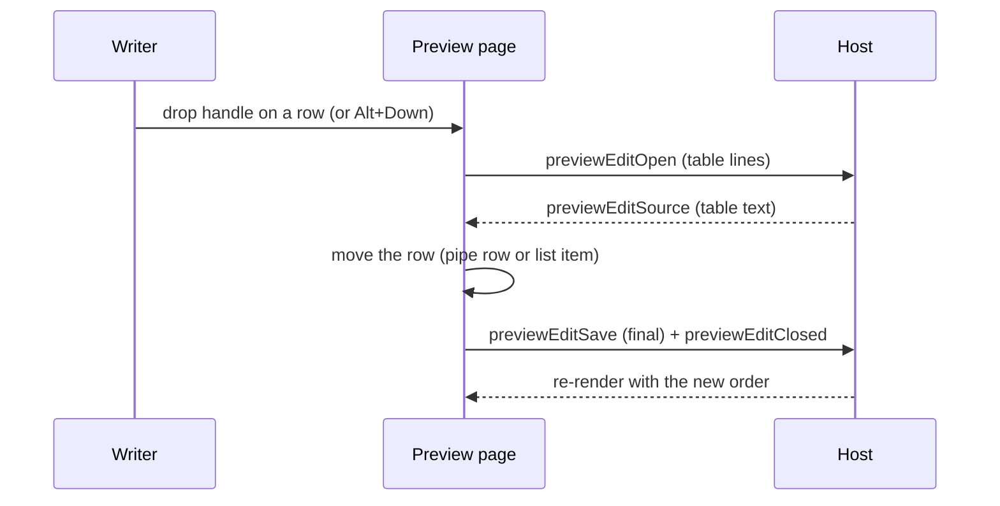

## Summary

Reordering the rows of a Markdown or MyST table meant cutting and pasting source lines. In edit mode
each body row of a pipe table or a MyST `{list-table}` now shows the same grab handle as the
frontmatter list editor, just left of the table and centred on its row. Drag it onto another row, or
focus it and press Alt+Up or Alt+Down, and the row moves. The header rows stay in place and one undo
puts the row back.

## Deliverables

Handles in edit mode: outside the table, centred on their row, on a short table and on a table that
fills the column (light, dark, cream):

| Light | Dark | Cream |
| --- | --- | --- |
|  |  |  |

A `{list-table}` gets the same handles. Its header rows (`:header-rows:`) stay fixed and a row moves
as a whole list item:

| Light | Dark | Cream |
| --- | --- | --- |
|  |  |  |

```text
* - apple             * - pear
  - sold by kilo        - sold in boxes
                    =>  * - apple
    more                  - sold by kilo
* - pear
  - sold in boxes           more
```

In a narrow pane a table that leaves no room on its left is pushed right by a handle's width, so
the handles are never clipped (pipe table and list-table, 360 px):

| Light | Dark | Cream |
| --- | --- | --- |
|  |  |  |
|  |  |  |

A table wider than the pane scrolls sideways; its handles stay outside the scrolling box and visible
(a fourteen-column table, scrolled):

| Light | Dark | Cream |
| --- | --- | --- |
|  |  |  |

While a handle is dragged over a row (mouse button held), the dragged row is dimmed and a line shows
where it lands:

| Light | Dark | Cream |
| --- | --- | --- |
|  |  |  |

The page reads the table source from the host, moves the row on the source and saves the whole
table once:



Decisions: pipe tables and `{list-table}` directives get handles (a captioned or HTML table, an
included table and the header rows do not); Alt+Up and Alt+Down work on the focused handle; the
handles live in a layer over the page, outside the table, because a table that scrolls sideways
would clip a handle placed inside it.

## Changes

- `src/page/features/tableRowMove.ts` (new): builds the handles in a layer of their own, places
  them from the row rectangles (resize and zoom follow), pushes a table right when it leaves no
  room, handles drag and drop, Alt+Up and Alt+Down, and saves the move through the existing
  open/save messages (no new message, no cell editor opened).
- `src/page/modules/markdownTable.ts`: `moveRow` reorders a body row of the table model
  (`serialize` keeps each line as written); `moveListTableRow` reorders the list items of a
  `{list-table}` on the text, with every line of an item, options and indentation untouched.
- The handle reuses the list editor's mark (`okf-list-editor-handle`); styles for the layer, the
  dragged row, the drop line and the pushed table are in `editModeStyles.ts`.
- A click on a handle opens no editor.
- Requirements: new StRS and SwRS `TABLE-002` (table-editing); update log and changelog.
- Visual: eighteen scenarios (`table-editing` v06 to v23), three fixtures, and a "drag and hold" page
  action in the capture script.

## Impacts

Edit mode shows a handle left of every body row of a pipe table or a list-table. A table with no
room on its left (narrow pane) is a handle's width narrower and pushed right, so it may wrap its
text earlier than in reading mode. Reading mode is unchanged. Known limits (listed in the
requirement): rows of captioned and HTML tables cannot be reordered with a handle, and a drag is
cancelled while an editor is open; the handles are placed for a left-to-right page.

## Blast radius

Grade: 1

Local to pipe tables and list-tables in edit mode: one new page feature, two model functions and
one stylesheet block; no host or protocol change. A plain `git revert` restores the previous
behaviour.

## Test plan

- [x] New or changed tests (they fail on the previous code): 2 model tests (`markdownTable`), 5
      list-table source tests, 9 page runtime tests (`runtimeTableRowMove`), 18 visual scenarios; the
      scenario count test.
- [x] Requirements: SwRS and StRS `TABLE-002` added, markers in code and tests,
      `okfreq validate`, `lint --check` and `update-coverage --check` clean (1013 requirements).
- [x] Local gates: `just check` (2638 unit tests, 2 contract, 46 security, all pass);
      `just ci-visual` 350 of 350 scenarios pass.
- [ ] Not run: a drag in a real VS Code window (the visual run uses a real mouse drag in Chromium
      against the page, but its host stub does not answer a save).
- [ ] Review
- [ ] CI green

## Internal references

CR 084 (table-row-reorder-handle); assets branch `changes-requests/084-table-row-reorder-handle-assets`.
The `check_preview_edit_mode` capture check now waits two frames after the toggle so a layout
change of edit mode settles before a later scroll.

🤖 Generated with [Claude Code](https://claude.com/claude-code)
