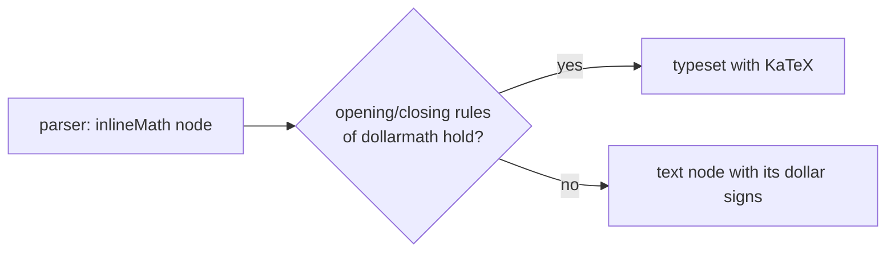

## Summary

The preview typeset prices as maths: `$5 and $6` showed `5 and ` as a formula between two removed
dollar signs, and `$19 base ... ($200)` and `$100–$380` broke the same way. Sphinx (markdown-it
dollarmath) keeps them as text, so the preview disagreed with the built documentation. The preview
now applies the same delimiter rules.

## Deliverables

A `$...$` span is maths only if the opening `$` is not followed by whitespace and the closing `$`
neither follows whitespace nor precedes a digit.

| Source | Before | After |
| --- | --- | --- |
| `$5 and $6` | formula "5 and " | text `$5 and $6` |
| `$19 base ... ($200)` | formula "19 base ... (" | text |
| `$100–$380` | formula "100–" | text |
| `$x$` | maths | maths (unchanged) |

## Changes

- New render pass `restoreDollarAmounts` (`src/core/render/mystInlineTransforms.ts`), run right
  after parsing: an inline-maths node that breaks the rules becomes text again, `$` signs included,
  and adjacent text is merged. `$$` blocks, `\(...\)` and the `{math}` role and directive are not
  touched.
- Requirement SwRS-MDOKFSTUDIO-MYST-024: the "Known issue" line is removed and the dollar-amounts
  scenario now states the new behaviour.
- Intent change of two visual scenarios, which pinned the old maths rendering of prices:
  `myst/v35` and `myst/v36` (fixture `55-dollar-prices`) now assert that the three price sentences
  hold no typeset span and keep their dollar signs, and that only the real `$x$` span is typeset.
- New unit test "dollar amounts stay text while a real dollar span is maths".

## Impacts

Documents that mention prices, e.g. `$5 and $6`, show the text as written. No other visual change. Two limits remain, as in the requirement: a price followed by a real span in the same paragraph (`$5 and $x$`) renders all as text, where Sphinx typesets `5, $x`; and `*a $5 and* $6` shows literal asterisks, where Sphinx emphasises the text.

## Blast radius

Grade: 1

One pass over inline-maths nodes; a plain `git revert` restores the previous behaviour.

## Test plan

- [x] New or changed tests (the new unit test fails on the previous code)
- [x] Requirements: SwRS-MDOKFSTUDIO-MYST-024 updated, markers in code and tests,
      `okfreq update-coverage` run
- [x] Local gates: `just check` (2639 unit tests, requirements lint, boundaries, limits, security), `just ci-visual` (341 scenarios passed)
- [ ] Review
- [ ] CI green

## Internal references

- CR 086 (dollarmath-align-sphinx)

🤖 Generated with [Claude Code](https://claude.com/claude-code)
