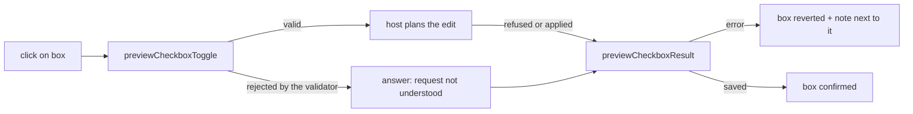

## Summary

Clicking a task checkbox that the host refuses (out-of-date preview, moved line, open editor,
read-only file) put the box back but explained why only in a tooltip, which is easy to miss. A
malformed toggle message was dropped without an answer, so its box stayed busy and ignored clicks
until the next render. A file opened outside any workspace folder was told "Editing requires a
trusted workspace", although trust is not the cause.

## Deliverables

```
before:  [ ] Open item                      (tooltip only, easy to miss)
after:   [ ] Editing needs the file's folder opened as a workspace folder in VS Code.  Open item
                                            (note next to the box for about 6 s, plus the tooltip)
```



Light:


Dark:


## Changes

- `src/page/features/checkboxes.ts`: the refusal reason is also shown in a `status` note after the
  box, removed after 6 s (a second refusal replaces it); style in `contentLayoutStyles.ts`.
- `src/session/pageMessages.ts`: a toggle the validator rejects, but that names its document,
  render and edit id, is answered with a refusal; one without them is still dropped.
- `src/core/edits/sourceEdits.ts`: the read-only reasons live in one place (`readOnlyReason`); the
  checkbox path names the missing folder for a standalone file and the missing trust otherwise.
- Requirements: GFM-021 and GFM-027 state the new behaviour, TRUST-005 gives both read-only reasons,
  the Known issue lines of this behaviour are removed (also from the superseded GFM-024 and GFM-026).

## Impacts

Visible: the refusal reason next to the box (screenshots above). The other read-only refusals (block
edit, frontmatter, comments, threads) and the tooltip of a disabled box keep their wording for now;
TRUST-005 keeps a Known issue for them. Existing assertion intent: none changed; the "rejected
toggle" page test gained assertions for the note and its removal.

## Blast radius

Grade: 1. Local to the checkbox feature and one extra answer in the page message dispatcher;
`git revert` restores the previous behaviour.

## Test plan

- [x] New or changed tests (they fail on the previous code, checked by stashing `src/`):
      `test/session/checkboxRefusal.test.ts` (2 tests), page test "a rejected checkbox toggle
      reverts the box and explains why" extended, visual scenarios `gfm/v05` and `gfm/v06`
- [x] Requirements: GFM-021, GFM-027, TRUST-005 updated, markers in code and tests,
      `okfreq validate` (1013 requirements, 0 errors), `lint --check` and `update-coverage --check` clean
- [x] Local gates: `just check` (2643 unit, 46 security tests pass), `just ci-visual` (353 scenarios pass)
- [ ] Review
- [ ] CI green

## Internal references

- CR 094 checkbox-refusal-feedback; the shared read-only wording is continued by the readonly-reason-wording CR.

🤖 Generated with [Claude Code](https://claude.com/claude-code)
