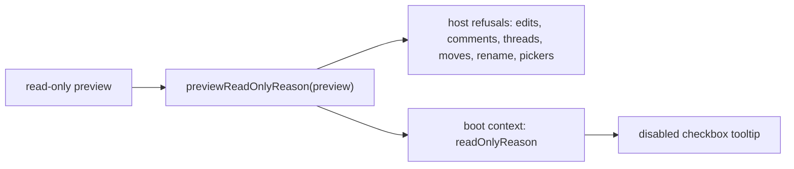

## Summary

A preview is read-only for two different reasons: the workspace is untrusted, or the file lies
outside every workspace folder. Several refusals (comments, threads, block edits, moves, rename,
palette pickers, the disabled checkbox tooltip) always blamed workspace trust, which is wrong and
unhelpful for a standalone file. They now share one reason that names the real cause.

## Deliverables

| Cause of the read-only preview | Text shown by every refusal and by the disabled checkbox tooltip |
| --- | --- |
| Untrusted workspace | Editing requires a trusted workspace. |
| File outside every workspace folder | Editing needs the file's folder opened as a workspace folder in VS Code. |

Also, the first load of a read-only page now builds its properties table without edit cells (it
used to carry them until the host replaced the table after the render).

## Changes

- `previewReadOnlyReason` (session) picks the text from the existing `readOnlyReason`; all host
  refusals call it instead of their own trust sentences.
- The boot context carries `readOnlyReason` for read-only pages; the page uses it as the checkbox
  tooltip.
- `buildPreviewWebviewHtml` passes the editing flag to the properties table.
- SwRS: TRUST-005 states the reason table and loses its three Known issue lines; TRUST-001 loses
  the properties table Known issue line; other SwRS that quoted the old per-type texts now point to
  the shared reason.

## Impacts

No visual change for trusted workspaces. Existing assertions changed wording only: the host
refusal tests for a standalone file now expect the missing-folder text instead of the trust text.

## Blast radius

Grade: 1. Only message texts and one argument of the first-load table; `git revert` restores it.

## Test plan

- [x] New or changed tests (they fail on the previous code: 9 failures with the old `src`)
- [x] Requirements: SwRS updated, markers in code and tests, `just requirements-update`
- [x] Local gates: okfreq validate, lint and update-coverage clean (1013 requirements); unit 2646
      pass, contracts 2, security 46 pass; integration and window suites not run
- [ ] Review
- [ ] CI green

## Internal references

Change request 095 (readonly-reason-wording), SwRS TRUST-005, TRUST-001.

🤖 Generated with [Claude Code](https://claude.com/claude-code)
