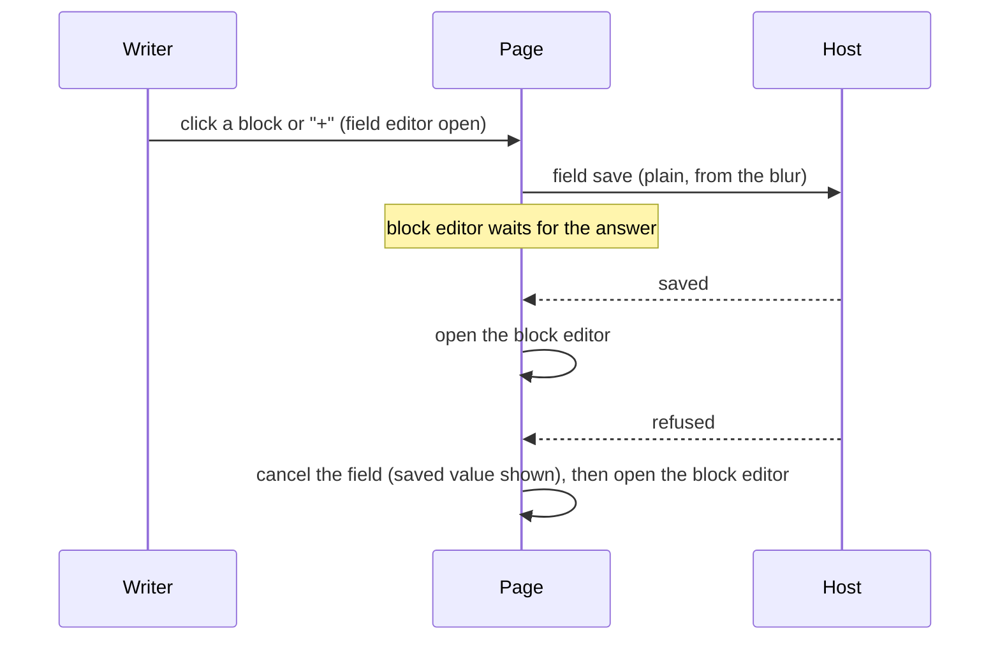

## Summary

With a frontmatter field editor open, clicking a block or a "+" insert point blurred the field
(posting its save) and opened a block editor at once. When the value was refused (invalid YAML such
as `[review`, or a value the schema refuses), the field stayed open in its error state next to the
block editor, and kept blocking every other field until Escape.

## Deliverables

| Field value | Before | After |
| --- | --- | --- |
| Valid | saved; block editor opened at once | saved; block editor opens when the save is answered |
| Refused | field stays open in error, block editor open too | field cancelled (saved value shown), refused text discarded, block editor opens |

## Changes

- `openBlockEditor` (`src/page/features/blockEditor.ts`) now looks at the open field editor: with a
  plain save pending it waits for the answer, then closes the field if the save was refused and opens
  the block; a field with nothing in flight is closed first.
- Requirements: the block-editing "one edit at a time" requirement gains a table row and a boundary
  scenario; the Known issue lines about this behaviour are removed here and in two superseded field
  requirements; the remaining one is narrowed to clicks on another field or the background.

## Impacts

No visual change. The block editor now opens after the host answers the field's save (instead of
before it), so there is a short delay when a valid field value is saved by the click.

An existing expectation changed in intent only in this sense: a click on a block with a field editor
open used to open the block editor immediately; it now opens it once the field's save is answered.

## Blast radius

Grade: 1. One function in the page runtime; a plain `git revert` restores the previous behaviour.

## Test plan

- [x] New or changed tests (they fail on the previous code): three page tests in
      `test/page/fmtableReqFrontmatter.requirements.test.ts` (refused value + block click, refused
      value + "+" insert point, valid value + block click); verified failing with `src` stashed
- [x] Requirements: SwRS updated, markers in code and tests, `okfreq update-coverage` (0 files change)
- [x] Local gates: `just check` (2649 unit tests, 46 requirements tests passing; okfreq validate
      with prose and links: 1013 requirements, 0 errors; lint and coverage checks clean)
- [ ] Review
- [ ] CI green

## Internal references

- CR 096 (field-editor-error-then-block-click)

🤖 Generated with [Claude Code](https://claude.com/claude-code)
