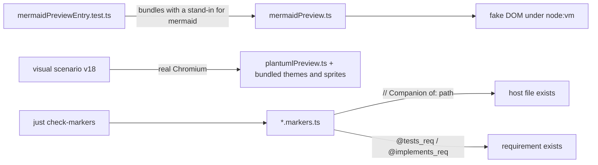

## Summary

Two diagram entry points (the Mermaid and the built-in PlantUML page scripts) had behaviour that
no test exercised, companion marker files (`*.markers.ts`) could silently outlive the file they
mark, and two style modules carried requirement markers for the whole file. This change closes
those gaps without changing any product behaviour.

## Deliverables

- Mermaid page tests: ids never repeat (also for replaced content), passes run one at a time,
  a drawing for an earlier theme never replaces the current picture, a failed drawing shows one
  error and sets the error state.
- PlantUML visual scenario: a class diagram with `!theme cerulean` and an OpenIconic icon is drawn
  by the built-in engine, with the theme colours, the icon and no network request.
- `just check-markers`: for each `*.markers.ts`, a `// Companion of: <path>` header whose host
  exists, only comment lines, and only known requirement ids.
- Markers of the first-element gap (LAYOUT-007) and the forced theme palettes (THEME-025) sit on
  the CSS constants that implement them.

## Changes

- `test/page/modules/entryHarness.ts` and `mermaidPreviewEntry.test.ts`: bundle the real entry
  script in memory with a controllable `mermaid` stand-in and run it in the fake DOM.
- `test/visual/`: fixture `63-plantuml-theme-sprite`, its assertions and scenario
  `diagrams/v18-plantuml-theme-sprite-light-900`.
- `scripts/check-marker-companions.mjs`, wired as `check:markers` / `just check-markers` in
  `just check`; documented in CONTRIBUTING.md and the requirements guideline.
- `contentLayoutStyles.ts` and `pageChromeStyles.ts`: the CSS is split into constants that are
  interpolated at the same position (the generated stylesheet is byte-identical).
- Requirements: DIAG-009 and DIAG-024 test lists, update log entry. The superseded DIAG-012, 013,
  014, 031 and 116 stay marker-free: their behaviour is DIAG-009 and DIAG-024.

## Impacts

No visual or behavioural change. Developers get a new `just check` step and a `// Companion of:`
header convention for marker companion files.

## Blast radius

Grade: 1. Tests, one check script and a CSS split with identical output; a `git revert` restores
the previous state. Not done here (listed for follow-up): the approximate tests, the end-to-end
tests of the StRS, and the markers of the large integration `run()` function.

## Test plan

- [x] New tests fail on the previous code: with the draw queue unchained and the id counter fixed,
      two of the four Mermaid tests fail; with the bundled theme and sprite imports removed, the
      PlantUML scenario fails (diagram not drawn, error shown)
- [x] Requirements: markers in code and tests, `just requirements-update`; validate, lint and
      update-coverage `--check` pass (1013 requirements)
- [x] Local gates: `just check` (2677 unit tests, contracts, security, release tests, requirements
      lint), visual scenario `diagrams/v18-plantuml-theme-sprite-light-900` passed, CSS output
      identical before and after the split
- [ ] Review
- [ ] CI green

## Internal references

CR 103 (requirements-test-quality); follow-up backlog item requirements-test-quality-rest.

🤖 Generated with [Claude Code](https://claude.com/claude-code)
