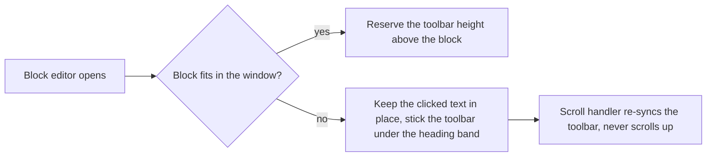

## Summary

The block edit toolbar (the floating bar of formatting buttons shown while a block is being
edited) could sit on top of the block editor. When it wrapped to two rows in a narrow preview, it
hid the first lines of the text being edited and, in the figure edit panel, the "Figure" title.
For blocks taller than the window, it sat in the middle of the block, and after pasting a long
text the page lost the caret and could jump back to the top.

Now:

- A block that fits in the window is never covered: the toolbar's height is reserved above it.
- A block taller than the window keeps the clicked text where it was when it opens. Its toolbar
  sticks at the top of the preview, just under the sticky heading band, and may cover the first
  lines while the text scrolls under it. Scrolling down never moves the page back up.
- After a large paste, a caret below the visible area is scrolled into view.

## Deliverables

Tall block opened while scrolled into it, real VS Code window, Cream preview. Before, the toolbar
sat under the preview controls, over lines 08 to 13; after, it is at the top of the pane.

| Before | After |
| --- | --- |
|  |  |

Right after pasting 90 paragraphs into an empty document. Before, the page stayed at the top while
the caret was far below; after, the page follows the caret.

| Before | After |
| --- | --- |
|  |  |

Blocks that fit in the window, two-row toolbar (headless, Cream preview on a dark host): the text
editor and the figure edit panel start below the toolbar.

| Before | After |
| --- | --- |
|  |  |
|  |  |

How the toolbar position is chosen when a block editor opens:

Tests: a new real-window test (`test/integration/tallBlockScroll.test.ts`) opens a tall block,
scrolls down one wheel notch at a time and checks that the page never moves up and the toolbar
stays at the top of the pane; a second case pastes a long text and checks that the caret is in
view. Both fail on the previous code. A unit test covers the caret reveal, and the headless visual
check for tall blocks follows the new rule.

## Autonomous decisions

- For blocks taller than the window, the toolbar sticks under the sticky heading band only when
  none of its buttons would be under the preview controls; in narrow panes, where they would be,
  it keeps sticking under the controls.
- A caret below the visible area is now revealed even when the toolbar is not stuck, which
  matches the editor's native behaviour.
- The headless visual check for tall blocks used to require scrolling the first rows into view on
  opening; it now checks that the clicked row stays in place and that scrolling never goes up.
- Known remaining behaviour, unchanged from main: after a large paste, re-rendering the preview
  closes the open editor and restores the last saved scroll position (now the caret's position
  instead of the top).

## Internal references

CR 123, SwRS-MDOKFSTUDIO-PALETTE-021.

🤖 Generated with [Claude Code](https://claude.com/claude-code)
