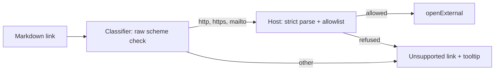

fix(security): open only http, https and mailto links outside VS Code

## Summary

A link in a Markdown document could carry a percent-encoded scheme. The preview classified it
as an external link from its decoded form, but handed the raw text to the operating system
opener, which then interpreted it as a local file path. This PR makes the scheme check strict on
the raw link text, adds a second check in the host, and renders refused links as unsupported.

## Deliverables

- Link classification reads the scheme on the raw string. A percent sign before the first colon
  means "not external": the link is never opened.
- The host parses the target with strict scheme parsing and only calls the external opener for
  `http`, `https` and `mailto`; anything else, or an unparsable value, is refused.
- A refused link has no click action and shows a tooltip naming the reason.
- No screenshots: the tooltip is a native `title` on a link that already had no click action.

## Changes

Classifier and resource policy, host opener, link sanitizer (tooltip), requirements
(link navigation and trust), plus tests.

## Impacts

Links with schemes other than http, https and mailto are no longer opened externally.

Blast radius: 2.

## Test plan

- Unit tests for the classifier, resource policy, sanitizer and host opener; each fails on the
  previous code.
- `just check`: all unit, contract, security and Python suites pass. The requirements coverage
  check reports files to re-sort; it fails identically on the unchanged base.
- Real-window trusted integration suite, including the preview history test: passes.

## Autonomous decisions

- Refused links are shown as unsupported links with a reason tooltip (no click action).
- The host failing to parse a value counts as a refusal.

## Internal references

CR 132 (backlog: link scheme check before open external).

🤖 Generated with [Claude Code](https://claude.com/claude-code)
