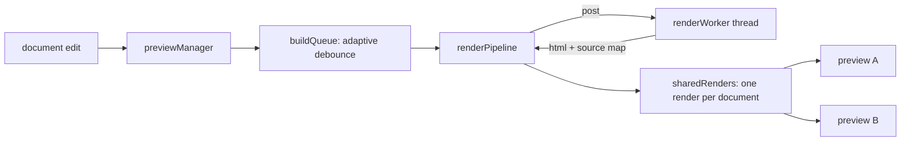

## Summary

An audit of the extension found a set of security gaps, avoidable work on every keystroke, an
oversized bundle, and several modules past the size limit. This PR lands all of the findings as 26
independent commits, each green on its own, so it can be reviewed per topic and merged with rebase.

- **Security**: the PlantUML JAR runs under a restricted profile, the comments sidecar refuses
  symlinks, the HTML sanitizer is bounded and stricter, and a Restricted Mode window no longer
  honours path settings or page-callable capabilities it should not.
- **Performance**: rendering moves off the extension host thread, front matter is parsed once,
  caches are content-addressed, the bundle shrinks by two thirds, and hidden previews stop costing
  memory and CPU.
- **Maintenance**: a Logger port, shared syntax primitives, a unused-exports check, the remaining
  `session` to `node-services` boundary debt retired, and every 700+ line module split.

## Deliverables

Measured with the repository's bench scripts on the same machine (Node 24), before and after:

| Measure | Before | After |
| --- | --- | --- |
| `extension.js` (minified) | 4.2 MB | 1.4 MB (highlighting 2.4 MB and KaTeX 0.26 MB load on first use) |
| Mermaid entry loaded with any diagram | 5.1 MB | 4 KB entry, 107 chunks fetched per diagram type |
| Host thread stall per render (11,123-line doc, 50 edits) | 344 to 1627 ms (equals the render) | 6 to 14 ms (render runs in a worker) |
| Front matter parses per page build | 4 | 1 |
| Foreign document change, 50 open previews | 1.5 ms, 150 `realpath` calls | 0.18 ms, 1.3 `realpath` calls |
| Host file watchers open (50 previews) | 100 | 51 |
| PlantUML processes for a repeated render of one source | 2 (one per render) | 1 (SVG cached by source hash) |
| Concurrent PlantUML processes for 5 diagrams | 5 | 2 (capped, queued) |
| `markdown-it-myst` source splits per parse (5 fences) | 5 | 1 |
| Highlight stage on an unchanged 10k-line document | about 50 ms | about 2 ms |
| Unchanged blocks rebuilt on a 200-block morph | all | 0 (stable keys) |

Rendering now runs in a worker with cancellation; the host only posts and receives:



Six modules over the size limit were split without changing their public API (code moved verbatim,
re-exported from the old file):

```text
src/page/modules/editPalette.ts          790 -> 673   + editPaletteTypes.ts      132
src/session/features/rendering.ts        785 -> 534   + pageDocument.ts           276
src/core/frontmatter/fileLinks.ts        682 -> 387   + fileLinkAnnotations.ts    315
src/core/protocol/pageToHost.ts          715 -> 333   + pageToHostMessages.ts     400
src/page/modules/markdownTable.ts        719 -> 426   + tableConversion.ts        311
src/session/previewManager.ts            680 -> 521   + sessionFactory.ts          215
```

## Changes

| # | Subject | Commit | Proof |
| --- | --- | --- | --- |
| 1 | Split source lines once per parse in the MyST tightness patch | e215ed3e | test counts `split` calls: 5 before, 1 after, same tightness values |
| 2 | Run the PlantUML JAR with a restricted security profile and size limit | 0c75030f | tests on the child's environment, arguments and Java resolution |
| 3 | Refuse a symlinked comments sidecar and write it atomically | 9dd67df5 | tests with a real file system; failed rename leaves no temp file |
| 4 | Harden the HTML sanitizer | 99a3de14 | tests: scripts and nonce attributes dropped, 50k removals in 220 ms, depth 10k cut with a marker |
| 5 | Single parse5 pass per page build | ad3dbec3 | sanitizer and CSP injection tests on one parse |
| 6 | Render hidden previews on show, share one render per document | a1d59c9a | tests: no render while hidden; refresh inside the join window re-renders |
| 7 | Stop retaining hidden preview webviews | 46412914 | test asserts `retainContextWhenHidden` is not set |
| 8 | Restrict path settings and gate page-callable capabilities in Restricted Mode | 5593083c | restricted-list, gesture-less copy refusal, include gate tests |
| 9 | Audit production dependencies, pin actions to SHAs, scope job permissions | 95c81b6a | workflow tests |
| 10 | Leave source maps, docs, `.claude` and `pyproject.toml` out of the VSIX | 4a578e6f | package-contents test (failed on the old ignore file) |
| 11 | Bounded content-addressed caches for highlight, KaTeX, toctree, schema listing | 0712337f | cache tests; highlight stage 50 ms to 2 ms |
| 12 | Cache PlantUML SVG by source hash, cap concurrent JVMs at 2 | eb499ec4 | spawns 2 to 1; peak concurrency 5 to 2 |
| 13 | Stable morph keys, single-flight layout, throttled code-copy placement | 7cea882d | node-count test: 200 blocks kept, 0 rebuilt |
| 14 | Drop superseded PlantUML runs in the page queue | 49a16102 | queue tests |
| 15 | Parse front matter once per unchanged text | 314b928e | parse count 4 to 1 |
| 16 | Cut event fan-out: shared watchers, canonical dependency sets, stem index | 4b83f17e | bench 1.5 ms to 0.18 ms per change; watchers 100 to 51 |
| 17 | Logger port and `fireAndForget` replace console calls and unobserved promises | f44836af | host and session suites on the fake host |
| 18 | Share fence, front-matter and escape primitives in `src/core/syntax` | c81e5a0c | existing suites unchanged and green |
| 19 | Dispose comments watcher, unobserve rescan links, bound dismissed banners, type paste events | 235d18ce | new unit tests per fix |
| 20 | Render MyST in a worker thread with cancellation and adaptive debounce | d8fa5234 | bench: host stall 344 to 1627 ms down to 6 to 14 ms |
| 21 | Apply the MyST source patches in memory instead of patching `node_modules` | 4e880d2f | build test; release job no longer runs a patch script |
| 22 | Split the real-input suite into `test/integration/realInput/` | 7bfbb990 | same scenarios, smaller files |
| 23 | Lazy-load highlighting and KaTeX, one YAML library, split the Mermaid build | 19a5d720 | bundle-split test: `extension.js` under 2 MiB, Mermaid entry under 200 KB |
| 24 | Add an unused-exports check to `just check`, remove dead exports | 31e56e02 | check fails on the 67 dead exports it removed |
| 25 | Retire the `session` to `node-services` boundary debt behind host ports | b64fbafd | boundary check passes with the exception list shrunk |
| 26 | Split the 700+ line modules into focused files | 43c7eea8 | `check-limits` passes with an empty size baseline |

Security items describe the class of input now refused: symlinked sidecar paths, over-deep or
very large HTML, scripts and nonce attributes in sanitized content, gesture-less capability calls
from the page, path settings read in a window that is not trusted, and PlantUML sources that reach
beyond the allowed profile.

## Impacts

No visual change. Users get a lighter, more responsive preview on large documents (the host thread
no longer freezes during a render), a smaller download, and stricter handling of untrusted
workspaces. Contributors get a Logger port, shared syntax primitives, and a stricter
`just check` (unused exports, size limits with an empty baseline).

## Blast radius

Grade: **3**. The PR touches the render pipeline, the bundle layout, CI and release workflows, and
the package contents. Each of the 26 commits is green on its own and reverts independently with
`git revert`; the worker render and the bundle split are the two to revert first if a regression
shows up in a real window.

## Test plan

- [x] New or changed tests (the new ones fail on the previous code)
- [x] Requirements: 87 StRS/SwRS IDs checked, 0 gaps, markers in code and tests,
      `just requirements-update` run
- [x] Local gates: `just check` green with okfreq 0.13.0 as CI pins it: 2893 unit tests, 2 contract
      tests, 66 security tests, 45 release-tests pytest; requirements: 1030 validated, 0 errors,
      0 indexes and 0 coverage files would change
- [ ] Review
- [ ] CI green, then heavy CI (`heavy=true`) on this branch

### Requirements traceability

94 requirement files changed; 87 requirement IDs checked, no leaf requirement lacks an
`@implements_req` or `@tests_req`. Representative IDs (all in the repository's traceability check):

| ID | Source | Tests |
| --- | --- | --- |
| SwRS-MDOKFSTUDIO-CORE-070 (new) | `src/core/render/mystTightness.markers.ts` | `test/build/mystSourcePatches.test.ts` |
| SwRS-MDOKFSTUDIO-CORE-013 | `src/core/render/mystRenderer.ts`, `src/core/security/resource-policy.ts` | `test/security/resource-policy.test.ts`, `test/core/render/includeBudget.test.ts` |
| SwRS-MDOKFSTUDIO-DIAG-084 | `src/core/render/plantUmlRenderer.ts` | `test/core/render/diagReq.jar.requirements.test.ts` |
| SwRS-MDOKFSTUDIO-DIAG-097 | `src/core/render/plantUmlRenderer.ts` | `test/core/render/plantUmlCache.test.ts` |
| SwRS-MDOKFSTUDIO-LIFE-004 | `src/node-services/renderWorker.ts`, `src/core/render/renderPipeline.ts` | `test/node-services/renderWorker.test.ts` |
| SwRS-MDOKFSTUDIO-LIFE-039 | `src/session/sharedRenders.ts`, `src/core/render/buildQueue.ts` | `test/session/sharedRenders.test.ts` |
| SwRS-MDOKFSTUDIO-LIFE-143 | `src/session/sharedWatchers.ts` | `test/session/eventFanOut.test.ts` |
| SwRS-MDOKFSTUDIO-FMSCHEMA-001 | `src/core/frontmatter/frontmatterParse.ts` | `test/core/frontmatter/frontmatterParseOnce.test.ts` |
| SwRS-MDOKFSTUDIO-CODE-001 | `src/core/render/highlight.ts`, `scripts/page-bundle.mjs` | `test/build/bundleSplit.test.ts`, `test/core/render/contentCaches.test.ts` |
| SwRS-MDOKFSTUDIO-LIFE-069 | `src/page/modules/contentMorph.ts` | `test/page/modules/contentMorph.test.ts` |
| SwRS-MDOKFSTUDIO-REVIEW-012 | `src/session/features/comments.ts` | `test/integration/commentWrite.test.ts` |

## Autonomous decisions

- Every remaining audit item became one commit, 26 in all, in one branch and one PR; each was
  built in parallel on a local branch and integrated one by one in numeric order, with `just check`
  after each so every commit is green alone. Some finished out of numeric order; the final order
  in the history is the numeric one.
- Task branches were never pushed; only this branch is.
- Locally, requirements checks used the okfreq version CI pins (`okf-schema==0.13.0`, via `uvx`)
  because the venv copy is older and lacks `--check-links`.
- Security descriptions here name the class of input refused, not a ready-to-use exploit.
- Performance claims carry before/after numbers from the repository's bench scripts; where a bench
  is noise-limited (whole-render warm-up ratio), the stage-level number is reported instead.
- No new dependency was added; one (a duplicate YAML library) was removed from the bundle.
- A shared `node_modules/markdown-it-myst` copy in a development checkout stayed patched by the
  old script; it is harmless and goes away with the in-memory patching.

## Not included

Nothing was blocked: all 26 items are in this PR. The real-window VS Code suites (for example
`previewEditing`, `commentWrite`) were not run locally during the overnight run because the screen
was locked; the heavy CI run on this branch is the proof for them. One stress run showed
alert-dropdown and frontmatter-rename timeouts that also occur on unchanged code.
Not done, deliberately out of scope: sending only changed top-level children from the host, and
bundling shims for the remaining small dependencies (`json5`, `he`, `csv-parse`, `parse5`).

## Internal references

CR 135 (audit security and performance pack), tasks T1 to T26 (commits in the order above);
`.agents/changes/03-requests/135-audit-security-performance-pack/` (request, TASKS.md, reports,
TRACEABILITY.md).

🤖 Generated with [Claude Code](https://claude.com/claude-code)
