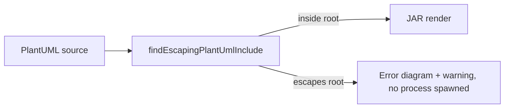

## Summary

The PlantUML JAR renderer runs with a restrictive security profile and the workspace folder as its
allowlist, but PlantUML's own check still let two kinds of include through: a path that climbs out
of the workspace with parent segments, and an absolute path into a sibling folder whose name starts
with the workspace folder name. This PR resolves `!include` lines in the extension before the JAR
starts and refuses any include that leaves the workspace, with a visible message.

## Deliverables

- `findEscapingPlantUmlInclude(source, workspaceRoot)` scans `!include`, `!include_many`,
  `!include_once`, `!includesub` and `!import`, follows nested includes (depth 8, 64 files) and
  compares paths by segments after realpath (never a string prefix), so symlink escapes and
  `ws-secret` next to `ws` are caught.
- Computed includes (`%fn()`, `$var`) cannot be checked and are refused; URLs and `<lib>` names are
  left to the JAR.
- The renderer hook is a few lines before the JAR is spawned.
- The known issue in the diagram-rendering requirement is removed; new tests cover each escape.

## Autonomous decisions

- Compare by path segments after realpath, resolve includes before the JAR runs, refuse with a
  visible message.
- Computed includes are refused (fail closed); this may break diagrams relying on `%dirpath()`.
- An absolute path is compared to the workspace root as given; a root reached through a symlinked
  alias is refused (safe side).
- `!theme ... from <path>` is not scanned yet (follow-up).

## Internal references

CR 137, requirement DIAG-084; builds on the PlantUML JAR security profile of CR 135 (T2).

🤖 Generated with [Claude Code](https://claude.com/claude-code)
