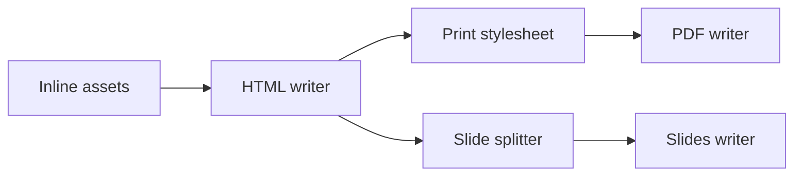
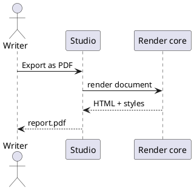

# Offline report export

We add one command that exports the current document as a single HTML file, a PDF or a slide
deck, with no server and no network. The work takes three weeks for two engineers; the first
week ships the HTML export alone, which already covers most requests.

[TOC]

## Architecture

All three outputs reuse the preview renderer, so a document looks the same on screen and on paper.
Only the last step differs per format.

```{figure} diagrams/architecture.svg
:width: 90%
:alt: Markdown sources go through one render core to HTML, PDF and slides

One render core feeds every output; a new format adds one writer, nothing else.
```

## Phases

::::{grid} 1 1 3 3
:::{grid-item-card} 1. HTML
:header: Week 1
Single-file export: styles, images and diagrams inlined.
:::
:::{grid-item-card} 2. PDF
:header: Week 2
Print stylesheet, page breaks, table of contents and page numbers.
:::
:::{grid-item-card} 3. Slides
:header: Week 3
One slide per H2, speaker notes from comments.
:::
::::

### Order of work



### Tasks and effort

```{list-table} Tasks
:header-rows: 1
:widths: 40 40 20

* - Task
  - Output
  - Effort
* - Inline images and fonts
  - HTML
  - 3 d
* - Print stylesheet and page breaks
  - PDF
  - 4 d
* - Split by heading, notes from comments
  - Slides
  - 5 d
* - Command, settings and docs
  - All
  - 2 d
```

```vega-lite
title: Effort per output (days)
width: 360
height: 140
data:
  values:
    - {output: HTML, days: 3}
    - {output: PDF, days: 4}
    - {output: Slides, days: 5}
    - {output: Command and docs, days: 2}
mark: bar
encoding:
  x: {field: days, type: quantitative, title: Days}
  y: {field: output, type: nominal, sort: -x, title: null}
```

## Decision: how to produce the PDF

::::{tab-set}
:::{tab-item} Headless browser
Reuses the exact preview page, so the PDF matches the screen. Needs a browser on the machine.
:::
:::{tab-item} Own layout engine
No dependency, but every block type needs print rules and many will drift from the preview.
:::
::::

:::{card} Decision
:header: Proposed 2026-10-28
:footer: Revisit after the HTML export ships
We use the headless browser and fall back to "print from the preview" when none is found.
:::

## How a user runs it



## Risks

> [!WARNING]
> Documents with remote images cannot be exported offline. The command lists them and stops.

- [x] Spike: the preview page prints cleanly from a headless browser
- [ ] Confirm font licences allow embedding in exports

<!-- TODO: confirm the page size with the documentation team -->
