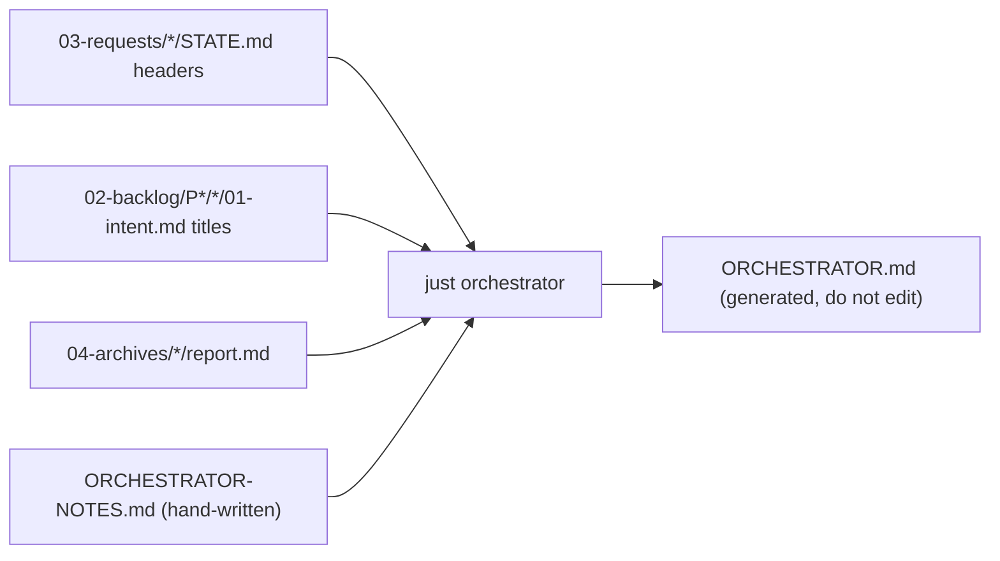

# Readable tickets in the Studio, and an ORCHESTRATOR.md that cannot drift

:::{important}
**Owner decisions, 2026-10-31.** User-facing tickets follow the
`skills/writing-for-markdown-okf-schema-studio/SKILL.md` skill, so they read well in the Studio.
Agent working files stay plain. ORCHESTRATOR.md tables are **generated by a script** from the
`STATE.md` headers and the folders: agents no longer edit them by hand. This repository only.
:::

## Intent (owner, verbatim French)

> idealement toi, les QA et tous les autres, quand vous levez des tickets vous pouvez utiliser
> skills/writing-for-markdown-okf-schema-studio/SKILL.md pour que ce soit vraiment beau. Encode
> dans le change-requests-workflow la ou le backlog et les taches sont decrite. pas necessaire pour
> tout ce qui n'est pas user facing. Donc oui pour intent, spec, mais les taches et autre details
> pas necessaire. Orchestrateur md et status user de chaque tache oui peuvent avoir UN PEU de
> syntaxe sucre mais le plus important c'est qu'ils soient maintenu sans corruption ni drift des
> agents.

## Which documents

| Document | Writing skill | Why |
| --- | --- | --- |
| `01-intent.md` (inbox and backlog) | ✅ yes | read by the owner |
| `00-request.md` | ✅ yes | the CR's spec, read by the owner |
| QA bug sheets, campaign `00-index.md` | ✅ yes | read by the owner at triage |
| `report.md` (archive) | ✅ yes | read by the owner |
| `ORCHESTRATOR.md` | ⚠️ a little | generated; one alert at the top, status icons |
| `STATE.md` header | ⚠️ a little | four fixed lines, machine-read: no syntax change |
| `task.md`, `rules.md`, `reports/`, `reviews/` | ❌ no | agent working files |
| SwRS and StRS requirements | ❌ no | strict okfreq format, schema-validated |
| PR bodies, GitHub issues | ❌ no | GitHub renders GFM only, never MyST |

## Generated ORCHESTRATOR.md

- One command rebuilds the Active, Backlog and Landed tables. It is idempotent: a second run
  changes nothing.
- The tables are generated, never edited by hand. The only hand-written part is a short notes file
  that the script includes as is.
- The `STATE.md` header format is checked: a header the script cannot parse is reported, not
  guessed.
- The sugar is limited to one alert at the top (date of the last run, number of active CRs) and a
  status icon per row (🟢 ready, 🟡 working or wait-ci, 🔴 blocked).
- The orchestrator runs the command at every CR transition and at landing, instead of editing the
  file.

## Change

1. `.agents/guidelines/change-requests-lifecycle.guidelines.md`:
   - a "Writing tickets" section with the table above;
   - steps 1–4 and 11 point to it;
   - the ORCHESTRATOR.md rules are replaced by "run `just orchestrator`".
2. The `rules.md` template (sub-agent rules): one line, "documents read by the owner follow the
   writing skill; working files stay plain".
3. The script and its unit test (a fixture tree with a broken header, a moved item and a landed
   CR), plus a `just orchestrator` recipe.
4. The QA bug sheet template goes into CR 211, which already edits that file.

## Done when

- [ ] The guideline names the documents that follow the writing skill, and those that do not.
- [ ] `just orchestrator` rebuilds ORCHESTRATOR.md from the tree. Its test covers an unparsable
      header and an item that moved from the backlog to a CR, the drift seen on 2026-10-31.
- [ ] A second run is a no-op.
