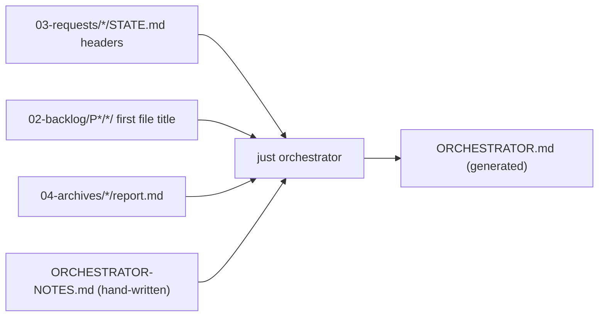

# 212 — Readable tickets in the Studio, and a generated ORCHESTRATOR.md

:::{important}
**Owner GO, via the Chief of Staff, 2026-10-31.** One subject: how tickets are written, and an
`ORCHESTRATOR.md` that agents can no longer corrupt. This repository only. One clean commit, one
ready PR from `origin/main`, never merge. The QA annotation helper is a separate CR (213).
:::

The full intent, with the owner's words, is in
[backlog-item/01-intent.md](../work/backlog-item/intent.md). This request keeps what the Coder needs.

## What changes

| # | File or tool | Change |
| --- | --- | --- |
| 1 | `.agents/guidelines/change-requests-lifecycle.guidelines.md` | A **Writing tickets** section: which documents follow the writing skill, which stay plain (table below). Steps 1–4 and 11 point to it. Every hand edit of `ORCHESTRATOR.md` becomes "run `just orchestrator`". |
| 2 | The `rules.md` template (sub-agent rules) | One line: documents read by the owner follow the writing skill; working files stay plain. |
| 3 | A script and `just orchestrator` | Rebuilds the Active, Backlog and Landed tables of `ORCHESTRATOR.md`. |
| 4 | A unit test with a fixture tree | Covers the cases listed under **Done when**. |

### Which documents follow the writing skill

| Document | Writing skill |
| --- | --- |
| `01-intent.md`, `00-request.md`, QA sheets and campaign `00-index.md`, archive `report.md` | ✅ yes |
| `ORCHESTRATOR.md` (generated), `STATE.md` header (four fixed lines) | ⚠️ a little, no format change to `STATE.md` |
| `task.md`, `rules.md`, `reports/`, `reviews/`, SwRS and StRS, PR bodies, GitHub issues | ❌ no: plain GFM |

## The generator

- **Sources:** the `STATE.md` headers of `03-requests/*`, the folders of `02-backlog/P*`, and
  `04-archives/*`. The only hand-written part is `ORCHESTRATOR-NOTES.md`, included as is.
- **Idempotent:** a second run changes nothing.
- **Strict:** a header the script cannot parse is reported by name, never guessed.
- **Sugar, a little:** one alert at the top (last run date, number of active CRs) and one status
  icon per row: 🟢 ready, 🟡 working or waiting for CI, 🔴 blocked.
- `.agents/changes/` is git-ignored: the script takes the changes root as an argument, with the
  repository's `.agents/changes` as the default.

> [!WARNING]
> Never run the generator on the live `.agents/changes/` of the main checkout from the worktree.
> Tests use fixtures only. The Foreman runs `just orchestrator` on the live tree after landing.

## Done when

- [ ] The guideline names the documents that follow the writing skill, and those that do not.
- [ ] `just orchestrator` rebuilds `ORCHESTRATOR.md` from the tree.
- [ ] The unit test covers an unparsable header, a landed CR, and **today's drift**: an item that
      moved from the backlog into a CR (`backlog-item/` folder) but is still listed in the Backlog
      table.
- [ ] A second run is a no-op (tested).
- [ ] Repository gates pass (`just check`), and one Conventional Commit with the trailer
      `Assisted-by: Claude:Opus-5.5`.
