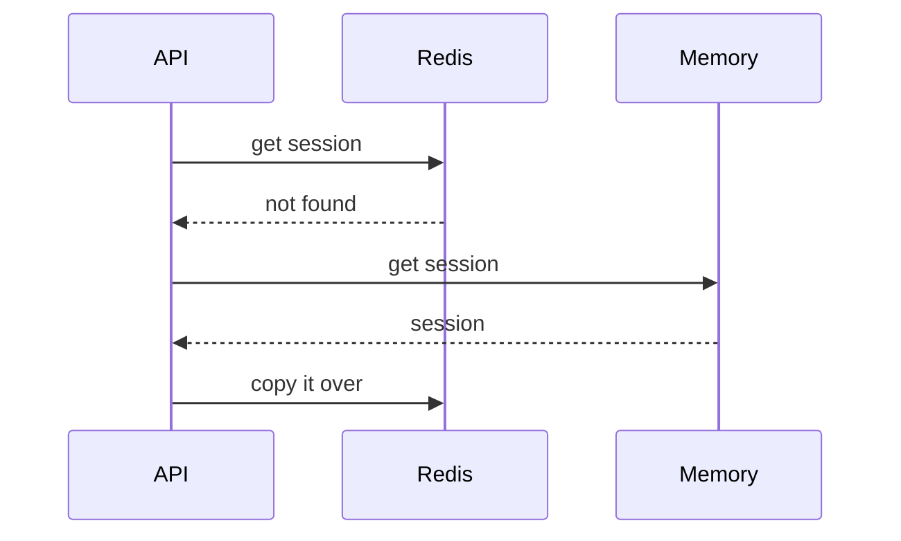

# Keep sessions across deploys

Every deploy logs everyone out today: the API keeps sessions in process memory. This plan moves
them to Redis in three short steps.

::::{grid} 3
:gutter: 2

:::{grid-item-card} Write to both
Week 1
^^^
New sessions go to memory and to Redis.
:::

:::{grid-item-card} Read from Redis
Week 2
^^^
Reads switch to Redis, with memory as a fallback.
:::

:::{grid-item-card} Drop the memory store
Week 3
^^^
The old store and the flag go away.
:::
::::

Which rollout do you want?

- (x) Behind a flag, one week per step (recommended)
- ( ) All at once, in the next release
