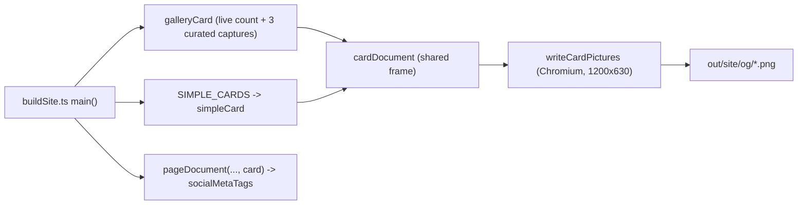

## Summary

A link to the published screenshot gallery shared on X or any site that reads Open Graph shows only a bare link. This PR gives the gallery page, and the home, Contributing and How we ship pages, a large picture card (Open Graph and Twitter meta tags plus a 1200 x 630 picture). The pictures are redrawn by the site build each time, so the gallery card always shows the live capture count.

## Deliverables

One module, `test/site/socialCard.ts`, holds the meta tags, the shared picture frame and the Playwright shooter. Each picture is an HTML template shot by Chromium once per build.



```ts
pageDocument(title, currentPage, body, card?: SocialCard) // tags after <title>; no card = unchanged page
await writeCardPictures(siteRoot, [{ name: "gallery", html: cardDocument(galleryCard(n, mosaic)) }, ...])
```

## Changes

- New `test/site/socialCard.ts`: `SITE_URL` (from `package.json`), `socialMetaTags`, `cardDocument`, `simpleCard`, `writeCardPictures`. It fails the build with a clear message when Chromium cannot start.
- `test/site/buildSite.ts`: `pageDocument` takes an optional card, `listCaptures` is shared by the page and the card, `galleryCard`, the `SIMPLE_CARDS` table, and `site-manifest.json` lists the four cards.
- CI: the `gallery` job uses `just dev-ci visual` (adds Chromium) and restores the Ubuntu package cache; the Pages `build-site` job installs Chromium before assembling from downloaded reports.
- New tests in `test/site/socialCard.test.ts`; `listCaptures` assertion in `test/site/gallery.test.ts`; "Social card" in the glossary.

## Impacts

Pictures drawn by the site build (light theme only). Pages without a card, such as the requirements page, are unchanged.

Before: no picture card and no Open Graph tags on these pages. After (1200 x 630, verified at ae16c9fb; the gallery card shows the live count of 542 captures):


## Blast radius

Grade: 2. Build tooling and two workflows only; the extension is untouched. The site build now needs Chromium, which `just dev`, `just dev-ci visual` and the Pages job provide. Revert restores the previous site.

## Test plan

- [x] New or changed tests (they fail on the previous code)
- [x] Requirements: No behaviour change (build tooling under `test/site/`, no SwRS)
- [x] Local gates: `just check`, workflow tests, `just preflight`
- [x] Review
- [x] CI green

## Autonomous decisions

- A `SIMPLE_CARDS` entry holds the card, eyebrow, headline and line together.
- `writeCardPictures` takes an optional template folder so its test leaves the real `out/site-cards` alone.
- The Contributing picture line reads "Setup, checks and the rules every change follows".
- Pictures use the system font stack, so glyphs differ slightly between macOS and Linux CI.

🤖 Generated with [Claude Code](https://claude.com/claude-code)
