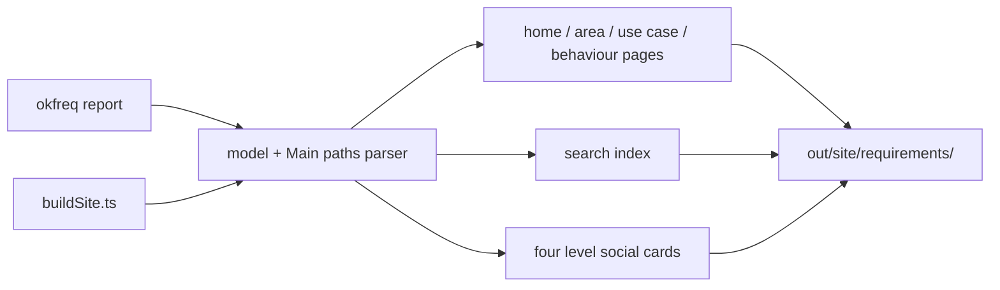

## Summary

The published Requirements page was one long page, and its figures were wrong: it counted every requirement as "unknown" because it read the lifecycle from the wrong front-matter key. This replaces it with a viewer a reader moves through one level at a time: the 16 areas, the use cases of an area, one use case drawn as a metro map of its main paths, and one behaviour with its rule, scenarios, source files and tests. Search works everywhere, and the pages read without JavaScript.

## Deliverables

| URL under `requirements/` | View |
| --- | --- |
| `/` | areas, figures, short explanation |
| `/<area>/` | use cases of the area |
| `/<area>/<StRS id>/` | metro map of the use case |
| `/<area>/<SwRS id>/` | behaviour: rule, scenarios, files, tests |

`requirements.html` now redirects to `requirements/`.

## Changes

- New `test/site/requirementsViewer/` (model, Main paths parser, page writers, metro layout, search index, level cards, assets); the old `requirementsPage.ts` is folded in and its marker companion renamed.
- Retired requirements are hidden; a History toggle shows them as rows.
- Figures now read `req_lifecycle` (fallback `lifecycle`): active counts replace the "unknown" ones.
- Shared head code with the social card tags; four level cards shot by the existing card mechanism.
- Requirements: SwRS CORE-069 amended, CORE-080 to CORE-085 added.

## Impacts

The published Requirements page becomes the viewer, and `requirements.html` redirects to it, so existing links keep working. Counts on the home page now come from the real lifecycle: the old page said "unknown" for every requirement. Before (old page) and after (viewer) are below.

Before:

After, light and dark home, a use case map, a behaviour:

## Blast radius

Grade: 2 - the site build and its public Requirements URL change; `requirements.html` redirects, and a plain revert restores the old page.

## Test plan

- [x] New or changed tests (they fail on the previous code)
- [x] Requirements: SwRS updated or added, markers in code and tests, `just requirements-update`
- [x] Local gates: `just check` green (3870 unit tests, main paths check, requirements checks); `just requirements-report`, `npm run compile`, `npm run site` build 572 pages; `just ci-static` and `just ci-visual` pass. `just ci-integration` (real VS Code window) failed twice here on a focus-sensitive step (once "Timed out waiting for Warning to change the type", once Chrome in front of the test window) in a change that touches no `src/` editor code; it is left to CI.
- [x] Review
- [x] CI green (static, static-windows, visual, report; the real-window integration job does not run on pull requests)

## Autonomous decisions

- The branch was rebased onto main after the two earlier site and requirements changes merged.

🤖 Generated with [Claude Code](https://claude.com/claude-code)
