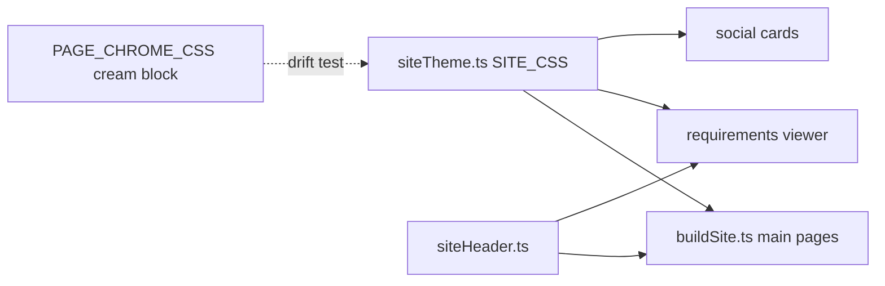

## Summary

The published GitHub Pages site had two looks: teal on light paper with a dark palette for the main pages, and a cream, sepia look with its own Theme button for the requirements viewer. This change gives every page and every social picture the one cream palette of the extension, the same typography and the same header, with no dark mode.

## Deliverables

| Before | After |
| --- | --- |
| Main pages: teal, dark mode from the system | Cream on every page |
| Viewer: own cream values, Theme button | Same tokens as the extension, no Theme button |
| Two headers (four and five links, a dot link in the viewer) | One header: logo and Home, Contributing, How we ship, Gallery, Requirements |
| Teal social cards | Cream social cards |

## Changes

- `test/site/siteTheme.ts`: the shared site stylesheet (cream tokens, fonts, base and header rules) replaces the dark theme source.
- `test/site/siteHeader.ts`: the single site header used by main pages and viewer pages.
- Main pages, viewer (stylesheet, shell, script), gallery and the social cards use the tokens; the viewer's theme switch and `req-theme` storage are removed.
- New SwRS SwRS-MDOKFSTUDIO-CORE-086 with its markers file; CORE-069 verification note updated; glossary terms added.
- A test fails when a site token drifts from the extension's cream block.

## Impacts

Before and after, light only (there is no dark mode), at 1280 x 800 and 375 x 812.

| Page at 1280 px | Before | After |
| --- | --- | --- |
| home |  |  |
| contributing |  |  |
| how-we-ship |  |  |
| gallery |  |  |
| reports |  |  |
| requirements home |  |  |
| area |  |  |
| use case |  |  |
| behaviour |  |  |

| Page at 375 px | Before | After |
| --- | --- | --- |
| home |  |  |
| contributing |  |  |
| how-we-ship |  |  |
| gallery |  |  |
| reports |  |  |
| requirements home |  |  |
| area |  |  |
| use case |  |  |
| behaviour |  |  |

Other checks at the pushed head: History on (`after-1280-req-history-on.png`), Search open, a system in dark mode (pages stay cream) and JavaScript disabled (Search and Play hidden, History works) are in the same screenshot branch.

Social pictures after the change:

| Picture | After |
| --- | --- |
| og-home |  |
| og-contributing |  |
| og-how-we-ship |  |
| og-gallery |  |
| requirements-og-areas |  |
| requirements-og-area |  |
| requirements-og-use-case |  |
| requirements-og-behaviour |  |

## Blast radius

Grade: 1. Site generation only; nothing in the extension changes. A plain `git revert` restores the previous site.

## Test plan

- [x] New or changed tests (they fail on the previous code)
- [x] Requirements: SwRS updated or added, markers in code and tests, `just requirements-update`
- [x] Local gates: `just check`, `just requirements-lint`; the full preflight passed its static and visual stages and failed only on real-window integration steps (see below)
- [x] Review
- [ ] CI green

## Autonomous decisions

- Headings h1 to h3 of Markdown pages are serif in the text colour; card headlines are serif, other card text sans; per-area colours of the viewer are unchanged (approved by the owner).
- One stylesheet source: it is written before the viewer's own rules and inlined in the main pages.

The heavy CI run (real VS Code) failed twice on a download timeout of the VS Code test runner, with a first run failing a real-window click step; none of these touch the site code.
