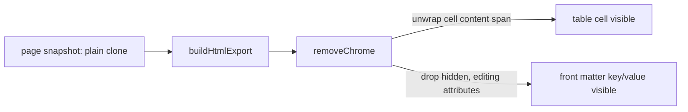

## Summary

Export to HTML lost what sat under an open editor. A table cell being edited was written to the file but could not be seen, and a front matter key or value being edited was written hidden. The export now writes the edited content as last rendered (the text already autosaved), and the editor stays open: the export neither closes nor commits it. A block under the block editor was already exported correctly; this is now pinned by tests.

## Deliverables

| Under an open editor | Before | After |
| --- | --- | --- |
| Paragraph / card / raw list-table | exported | exported (pinned by test) |
| Table cell | in the file, hidden by a style rule | visible |
| Front matter key or value | in the file, `hidden` | visible |

## Changes

- `removeChrome` in the export content step unwraps the table cell content span, and a pre-pass removes `hidden` from the front matter display elements under an open editor; the editing attributes are dropped.
- New page-level test opening the real editors and feeding the snapshot to the export; three new unit tests; a visual scenario with a cell editor open, opened with JavaScript off.
- The requirement for Export to HTML loses its Known issue row and describes this behaviour; changelog line added.

## Impacts

No visual change in the app. The exported file, opened with JavaScript off, with a table cell editor open at export time:

| Before | After |
| --- | --- |
|  |  |

## Blast radius

Grade: **1**. Local to the export content step; a plain `git revert` restores the previous behaviour.

## Test plan

- [x] New or changed tests (they fail on the previous code)
- [x] Requirements: SwRS updated, markers in code and tests, `just requirements-update`
- [x] Local gates: `just check` (green: format, compile, boundaries, unit and contract tests, requirements lint); the three export visual scenarios (two existing, one new with the cell editor open) pass; the new one fails without the fix
- [x] Review
- [x] CI green (heavy run: integration and stress included)

## Autonomous decisions

- The exported file shows the last rendered (autosaved) state; Export triggers no save (as specified).

## Internal references

CR-310 export-html-drops-block-being-edited; visual scenario toolbar-navigation/v44.

🤖 Generated with [Claude Code](https://claude.com/claude-code)
