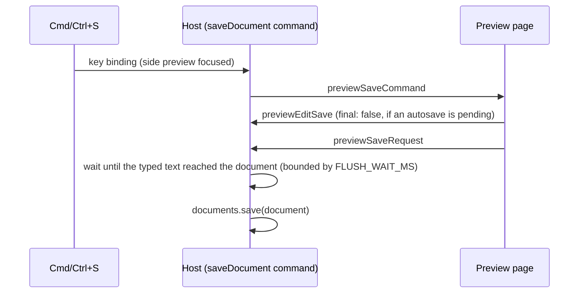

## Summary

With the focus in the side preview (after an edit, in a block or table-cell text box, in a
frontmatter field of the properties table, or anywhere else in the page), Cmd+S on macOS and Ctrl+S
elsewhere did nothing: the writer had to focus the source editor first. They now save the Markdown
document the preview shows. An open block or cell editor stays open with its caret, after the text
typed so far is written to the document; an open frontmatter field writes its value and closes, as
a navigation does.

## Deliverables

The page flushes its pending autosave before asking the host to save, so the document is never
saved just before the 400 ms autosave and left dirty again.

## Changes

- New command `markdown-okf-schema-studio.saveDocument`, hidden from the Command Palette, bound to
  `ctrl+s` / `cmd+s` when the side preview is the active webview panel (rebindable in Keyboard
  Shortcuts).
- New messages `previewSaveCommand` (host to page) and `previewSaveRequest` (page to host).
- Page: flushes the pending block or cell autosave without closing the editor, flushes an open
  frontmatter field, then posts the save request.
- Host: waits (bounded) for the edits to land, then saves; saves directly when the page is not ready.
- New requirement SwRS-MDOKFSTUDIO-LIFE-173, user guide paragraph, changelog line.

## Impacts

No visual change: the key now saves from the preview. Real-window proof: see the heavy run below.

Custom editor (decision on the binding): RESULT_PLACEHOLDER

## Blast radius

Grade: **1**. A new command and two messages; no existing behaviour changes. `git revert` restores
the previous behaviour.

## Test plan

- [ ] New or changed tests (they fail on the previous code)
- [x] Requirements: SwRS-MDOKFSTUDIO-LIFE-173 added, markers in code and tests, `just requirements-update`
- [ ] Local gates: `just check` passed; preflight: PENDING
- [ ] Review
- [ ] CI green

## Autonomous decisions

- Derives from StRS-MDOKFSTUDIO-BLOCK-008 (BLOCK-025 is approved and would have changed).
- The cell page test lives in its own file because the existing one is at the file-size cap.

## Internal references

CR-312 cmd-s-from-preview-focus, batch-02.

🤖 Generated with [Claude Code](https://claude.com/claude-code)
