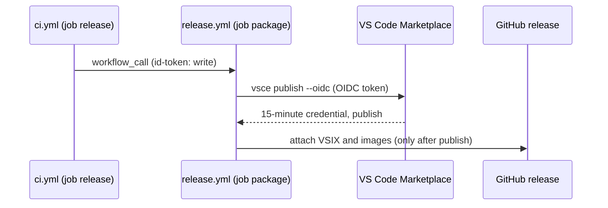

## Summary

The release job now publishes to the VS Code Marketplace with GitHub Actions OIDC (Marketplace Trusted Publishing) instead of the long-lived `VSCE_PAT` secret. The workflow proves its identity with an OIDC token and receives a Marketplace credential valid for 15 minutes; the workflow reads no stored secret. Azure DevOps global PATs are reported to retire on 2026-12-01 (community report, not confirmed by Microsoft).

## Deliverables

| | Before | After |
| --- | --- | --- |
| Auth | `VSCE_PAT` secret, checked by a "Verify Marketplace token" step | OIDC, `vsce publish --oidc` |
| `package` job permissions | `contents: write` | `contents: write`, `id-token: write` |
| `ci.yml` job `release` permissions | inherited | `contents: write`, `id-token: write` |
| `@vscode/vsce` | 4.0.0 | 4.1.0 (first with `--oidc`) |

## Changes

- `release.yml`: `id-token: write` on `package`; "Verify Marketplace token" removed; "Publish to VS Code Marketplace" runs `vsce publish --oidc --skip-duplicate` with no `env`. It still runs before the GitHub release step, so a failed exchange fails the job before the release is written.
- `ci.yml`: the caller job `release` grants `id-token: write` (a called workflow cannot exceed its caller's permissions).
- `@vscode/vsce` raised to 4.1.0 (`package.json`, lock file). The `overrides` are kept.
- `CONTRIBUTING.md` and the release-process guideline describe the policy, the failure recovery (fix, then dispatch **Release VSIX** with the existing tag; in an emergency a local `vsce publish` with the owner's PAT) and that there is no automatic PAT fallback.
- A workflow test locks the new setup.

## Impacts

No visual change: CI and release configuration only. Local evidence: `vsce --version` prints 4.1.0 and `vsce publish --help` lists `--oidc`; `git grep VSCE_PAT -- .github/` prints nothing; `just package` builds the VSIX; `just check` passes.

The first real proof is the 1.8.1 release, run right after this merges. `VSCE_PAT` stays in the `release` environment until a release published with `--oidc` succeeds, then the owner deletes it.

## Blast radius

Grade: 3. It changes the release path and publication authentication. Rollback is a revert plus the still-present `VSCE_PAT`. Open risk: the Marketplace policy may match the caller workflow (`ci.yml`) rather than `release.yml`; if so, a publish through CI fails and a `workflow_dispatch` of `release.yml` with the tag is the recovery (or a second policy for `ci.yml`, the owner's decision).

## Test plan

- [x] New or changed tests (they fail on the previous code)
- [x] Requirements: No behaviour change (release hardening, no SwRS covers it)
- [x] Changelog: No user-facing change
- [x] Local gates: `just check` and `ci-static` passed. Local `just preflight` failed in `ci-visual` and the real-window `ci-integration` (Shottr took window focus; steps timed out, visual "text not found"). The owner accepted the branch heavy CI run (`integration`, `stress`) as the gate instead.
- [x] Review
- [x] CI green: heavy run 43445113627 on head 1a881c4 (integration, stress, static, visual success)

## Autonomous decisions

- None beyond the specification.

## Internal references

CR-315 marketplace-trusted-publishing (batch-03).

🤖 Generated with [Claude Code](https://claude.com/claude-code)
