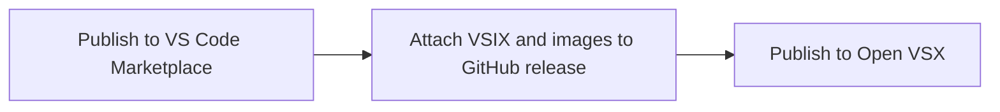

## Summary

Studio is now published to Open VSX (for VSCodium, Cursor and other compatible editors) by the same release job that publishes to the VS Code Marketplace, using Open VSX trusted publishing (GitHub Actions OIDC). No token is stored or read: no `OVSX_PAT` secret exists, and none must be added. The trusted publisher is already registered on open-vsx.org (provider GitHub, owner `gsemet`, repository `markdown-okf-schema-studio`, workflow `release.yml`, environment `release`).

## Deliverables

The release job `package` gets one last step, so an Open VSX failure never blocks the Marketplace or the GitHub release:



```yaml
- name: Publish to Open VSX
  run: npx --no-install ovsx publish --trusted-publishing --skip-duplicate --packagePath out/reports/package/markdown-okf-schema-studio.vsix
```

`--trusted-publishing` fails instead of falling back to a token; `--skip-duplicate` makes a re-run safe.

## Changes

- `ovsx` 1.4.0 as a pinned devDependency (`package.json`, lock file). `@vscode/vsce` stays a single 4.1.0 (deduped). The lock diff is large because `ovsx` brings its own dependencies.
- `release.yml`: the "Publish to Open VSX" step above; a workflow test covers it (command, no `env`, no `continue-on-error`, no `OVSX_PAT`, order, `id-token: write`, environment `release`).
- `CONTRIBUTING.md`: release step, trusted publisher settings, recovery of an Open VSX failure.
- Release guideline: watch both registries for 10 to 15 minutes after the release job; install links of both registries in the release notes.
- README, user docs and the writing skill: VS Code installs from the Marketplace, VSCodium, Cursor and other editors from Open VSX, with both links.
- Left alone: the announcement thread post 3 (Marketplace link only) and a demo-video storyboard link box.
- Cursor compatibility: a report is filed in the maintainers' inbox (no fix).

## Impacts

No visual change. Users get an Open VSX install link in the README and docs.

`npm audit` goes from 2 to 3 moderate advisories (minimatch, GHSA-g3hv-75wg-m249, reached through `@vscode/vsce`, now also listed under `ovsx`); no high or critical, so no override was added.

Not proven until the next release (v1.9.0, the first automatic publication):
- the Open VSX trusted publisher accepting the OIDC token when `release.yml` is called from `ci.yml` (the token names the caller in `workflow_ref`); if not, the fallback is a manual dispatch of the release workflow with the existing tag;
- the publication itself. Version 1.8.1 is not on Open VSX and is not backfilled here.

## Blast radius

Grade: **3** (release). The step is last and has no effect on the Marketplace publication; revert the commit to remove it.

## Test plan

- [x] New or changed tests (they fail on the previous code)
- [x] Requirements: No behaviour change (release hardening, no SwRS)
- [x] Local gates: `just check` passes; local `just preflight` static stages pass, its visual and integration stages fail on a focus-dependent real-input step and a Sphinx preview check in code this PR does not touch, so the branch heavy run is the proof
- [ ] Review
- [x] CI green (pull request checks and the branch heavy run, integration and stress included)
