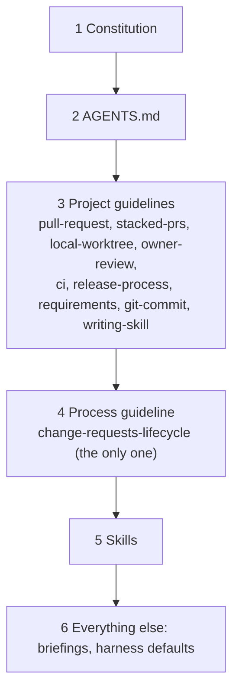

# Audit: lifecycle guideline against Chantier 0.5.0

Compared: `.agents/guidelines/change-requests-lifecycle.guidelines.md` at `8e08d00f` (518 lines) with
Chantier `v0.5.0` (`ef50fb6`: README, skill, cards, CLI). Line numbers refer to the guideline.

> [!IMPORTANT]
> Approved by the owner on 2026-11-05, with the recommended answers to D1, D2 and D3.

[TOC]

## Result in short

- About 70% of the guideline (some 365 of 518 lines) is generic: Chantier has the same concept. It
  stays, renamed.
- About 30% (some 150 lines) is project policy that must survive a change of process. It moves to
  four new guidelines and to `requirements.guidelines.md`.
- `state-file.guidelines.md` is generic and joins the lifecycle guideline.
- `release-process.guidelines.md` splits: the procedure stays, the role goes to the lifecycle.
- Chantier already ranks project rules above its own cards, so the precedence below matches it.

**The test used to classify a rule**: would it still have to hold if another process ran the work?
If yes, it is a project rule, even when Chantier has something close. If it only says how this
process runs its agents, it is generic.

## Target precedence

- **Rule**: the process says who does what and when; project guidelines say what the work must
  respect. On a conflict the project guideline wins, and the conflict is reported. Where they are
  silent, the process holds. Chantier's rule 0 says the same.
- **`AGENTS.md`**: the precedence list gains level 4, and a "Process" section holds the only link to
  the lifecycle guideline.
- **Constitution**: its opening line names the same order, and a short new section states the rule.
  Its section 4 "Details" link moves to `pull-request.guidelines.md`.
- **Isolation rule**: no project guideline and no constitution text links to the process guideline,
  and none names a process role. `chantier rules` follows links two levels deep from `AGENTS.md`, so
  one remaining link would put the old process back above Chantier's cards.

**Acceptance check**: remove the "Process" line from `AGENTS.md`, run `chantier rules`, and the
lifecycle guideline is not listed. Every project rule still is. A small test in `test/build/` can
hold the isolation rule (no link, no role name in project guidelines).

## Classification by section

| Lines | Section | Verdict | Goes to |
| --- | --- | --- | --- |
| 8-27 | Vocabulary | generic | lifecycle, renamed |
| 29-47 | Layout | generic | lifecycle, renamed |
| 49-69 | Roles, models, escalation, "never move a task up" | generic | lifecycle |
| 73-85 | Steps 1 to 11 | generic | lifecycle; steps 8 and 11 lose their project details |
| 87-93 | Requirements traceability | **project** | `requirements.guidelines.md` |
| 95-104 | Approved requirements | **project** | `requirements.guidelines.md` |
| 106-109 | Round limit | generic | lifecycle |
| 111-112 | Rebase rule | generic | lifecycle (history itself is in constitution 4) |
| 114-116 | `STATE.md` header | generic | lifecycle, absorbs `state-file.guidelines.md` |
| 118-130 | Writing tickets | **project** | `owner-review.guidelines.md` |
| 132-148 | `just orchestrator` | generic | lifecycle (tool of this process) |
| 150-167 | Parallel run, tree | generic | lifecycle |
| 171-180 | Worktree: `node_modules`, `uv sync` | **project** | `local-worktree.guidelines.md` |
| 182-187 | Branch names | generic | lifecycle; the `-assets` name goes with screenshots |
| 189-232 | Dashboard shape | generic | lifecycle |
| 231-232 | "Name each PR, CR, run or file with its link" | **project** | `owner-review.guidelines.md` |
| 235-247 | `caffeinate`, locked screen | **project** | `local-worktree.guidelines.md` |
| 249-297 | Responsiveness, Foreman session and loop | generic | lifecycle |
| 299-306 | Planning a release | generic | lifecycle |
| 308-335 | Tick, supervision, verify before reporting | generic | lifecycle |
| 337-351 | Driver prompt | generic | lifecycle |
| 353-358 | "Always stack": the requirements bundle conflicts | **project** | `stacked-prs.guidelines.md` |
| 360-373 | How a stack works, `gh stack` | **project** | `stacked-prs.guidelines.md` |
| 375-381 | Order of a stack | **project** | `stacked-prs.guidelines.md` (Chantier gives no order) |
| 383-398 | Stack driver, stack mode | generic | lifecycle |
| 394-396 | No auto-merge | **project** | `stacked-prs.guidelines.md` |
| 400-410 | Stack driver prompt | generic | lifecycle; "rerun `just requirements-update`" goes to `stacked-prs` |
| 412-416 | Demo tour | **project** | `owner-review.guidelines.md` |
| 418-447 | PR body for an external reader | **project** | `pull-request.guidelines.md` |
| 451, 454 | One driver per worktree, no agent starts an item | generic | lifecycle |
| 452-453 | App-window tests one at a time | **project** | `local-worktree.guidelines.md` |
| 455 | English everywhere | **project** | already constitution 7; removed here |
| 456-457 | "Autonomous decisions" in the PR body | **project** | `pull-request.guidelines.md` |
| 458-459 | `\rm`, `\cp`, `\mv` | **project** | `local-worktree.guidelines.md` |
| 461-479 | Sub-agent rules | mixed | lifecycle; 471-477 goes to `requirements`, 467-468 to `owner-review` |
| 481-497 | Screenshots in the PR | **project** | `pull-request.guidelines.md` |
| 499-518 | `report.md` | generic | lifecycle |

**Other files**:

- `AGENTS.md`: the `STATE.md` entry goes; one "When…" line per new guideline.
- `ci.guidelines.md` rule 10: points to `pull-request.guidelines.md`.
- `.agents/skills/change-requests-factory/`: unchanged, it only points to the process.
- PR 320 moved the PR rules into `ci.guidelines.md`. A dedicated file is better: PR writing is not
  CI, and the template already stands alone.

## Release split

Chantier expects "the project's own procedure" and holds none, so the procedure must read with no
role name.

| Stays in `release-process.guidelines.md`, in neutral words | Moves to the lifecycle |
| --- | --- |
| Why a release is green before the version commit exists (l.11-14) | "Planned by the Foreman" (l.9-10) |
| Agreeing the version; the stack lands first; hold other merges (l.76-81, neutral) | Role of the release driver (l.16-25) |
| Heavy run on `main` HEAD, version commit, monitoring, re-run once (l.84-107) | Release driver prompt (l.39-53) |
| Fix PRs may be merged on the owner's standing permission; the owner merges the version PR (l.26-28) | "Fixes go through the Foreman" as a route (l.29-30) |
| Nothing is asked between notes review and publication, except a real blocker (l.33-35, 109-110) | Watch slices, header writing (l.36-37) |
| Notes, thread, images, hero image (l.112 to the end) | Release CR folder and its `00-request.md` (l.57-63) |

> [!WARNING]
> "Asks nothing between notes review and publication" is stricter than Chantier's default, which
> waits for the user before each irreversible action. It stays a project rule; a Chantier test will
> need `--autonomous-releases` and a budget to honour it, because the CLI refuses otherwise.

## Vocabulary alignment

| Today | After | Note |
| --- | --- | --- |
| `01-inbox` to `05-trash` | `1-inbox` to `5-trash` | owner's decision |
| Main session | Chief of Staff | |
| Orchestrator, foreman | Foreman | one word instead of two |
| Reviewer | Inspector | verdicts `APPROVE`, `FIX-REQUIRED` are already the same |
| Coder, CR driver, stack driver, release driver | same | |
| Conflict-resolver (inside a prompt) | Conflict resolver, named as a role | |
| Tick | Heartbeat | the value stays 270 s |
| `STATE.md` | `STATUS.md` | same four-line header, still written by the agent |
| `02-decisions.md` | `02-answers.md` | |
| `00-request.md` | `03-change-spec.md` | see D2 |
| `reports/`, `reviews/` | `work/coder/`, `work/inspector/` | see D2 |
| `ORCHESTRATOR.md`, `just orchestrator` | see D1 | |
| `FOREMAN-BRIEF.md` | `3-requests/brief.md` | no batch folder here |
| `<repo>-wt-NNN` | `<repo>.worktrees/NNN` | |
| `change-requests/NNN-<slug>` | unchanged | a `chantier/` prefix makes no sense without Chantier |
| `NNN-<slug>` in archives | unchanged | Chantier's regex reads both forms |

Not aligned because it is structure, not a name: the batch level in `3-requests/`, `batch.json`,
`STATUS.json`, `intake/`, the CLI.

### What the folder rename touches

- `.agents/changes/`: five `mv` in the main checkout, 265 archives untouched inside.
- In the repository, nine files: the lifecycle, release and state guidelines, `AGENTS.md`, `justfile`,
  `scripts/generate_orchestrator.py`, its test, and the QA skill with `coverage-map.py`.
- 42 local documents hold relative links to the old names. They would break; see D3.
- The local `mv` must happen when the PR merges, or `just orchestrator` fails on one side.

### What it gives a Chantier test

Checked in the CLI: with the same folders, Chantier reads our inbox and backlog directly, ignores
our `NNN-<slug>` folders in `3-requests/` (it only sees folders with a `batch.json`), and continues
the numbering after our archives, since it takes the highest number found there. The old
separate tree and the CR-101 numbers are no longer needed.

## Differences kept out of this work

A pure move, as decided. Listed so they can be picked later, one by one.

| Chantier has | We have | Worth a look? |
| --- | --- | --- |
| Verifier: proof at the pushed head, by someone else | Reviewer before commit, then CI | yes: closes the overclaims seen in PR 316 |
| One long gate at a time, with a lock | "App-window tests one at a time", by hand | yes |
| Debugger; "after two failed fixes, test the premise" | Coder retries | yes: the focus flake took several wrong theories |
| Investigator before round 1 | None | maybe |
| QA driver on `main` HEAD | Separate QA skills | maybe |
| Budget, measured cost | None | maybe |
| Triage: automatable, or a spec the owner reviews | Grill for every item | maybe |
| Retro after a release | None | maybe |
| "No fallback": stop rather than work around | "Blocked" only when no sub-agent starts | maybe |
| Heartbeat 55 min, drivers on Opus | 270 s, drivers on Sonnet | owner's call |
| Orders and hand-backs written before sending | `STATE.md` and messages | no, needs the CLI |

## Inconsistencies found

Corrected in the same work, since moving them as they are would copy the errors.

- `approved_on` (l.99, l.103) against `approved_at` in `requirements.guidelines.md`. The latter is
  the okfreq field; verify with `okfreq validate` before changing.
- Step 11 updates an `INDEX.md` that does not exist in `04-archives/`.
- l.163 gives the Foreman "merges, landing" while l.57 says it never merges PRs, and l.454 and the
  constitution reserve merges. Only the landing is meant.
- l.454 "no agent merges a PR" against the release driver's right to merge fix PRs: the exception
  must be stated.
- l.152 presents stacking as optional; l.355 and the owner's practice make it the rule for parallel
  CRs.
- `.agents/changes/backlog/` is a leftover of the Chantier evaluation, outside the lifecycle.

## Decisions needed

**D1. Name of the generated dashboard.** Chantier writes `3-requests/STATUS.md` itself. If ours has
the same name, each tool overwrites the other during a test.

( ) Rename to `3-requests/STATUS.md`, `just status`: full alignment, and we simply do not run ours during a test
(x) Keep `ORCHESTRATOR.md` and `just orchestrator`: no collision, one name stays different

**D2. Files inside a CR folder.** `00-request.md` and `task.md` have no exact equivalent:
Chantier's specification is one self-contained file.

(x) Names only: `00-request.md` becomes `03-change-spec.md`, `reports/` and `reviews/` go under `work/`; `task.md` and `rules.md` stay
( ) Also merge `task.md` into `03-change-spec.md`: closer to Chantier, but a change of process, not a move
( ) Keep every file name inside a CR folder: only the stage folders and roles change

**D3. The 42 local documents with old links.**

(x) Rewrite the links with a script at the rename, in `.agents/changes/` only
( ) Leave them broken: they are history

## Work plan after your go

1. One pull request, stacked on nothing: rules first (new guidelines, lifecycle, release, constitution,
   `AGENTS.md`), then the script, test and QA skill for the new names.
2. Gates: `just check`, `test/build/test_generate_orchestrator.py`, the isolation test.
3. On merge: the local rename of `.agents/changes/`, `just orchestrator`, link rewrite per D3. The rename script
   also covers active CRs (`STATE.md`, `00-request.md`, `reports/`, `reviews/`), `FOREMAN-BRIEF.md`, backlog
   `02-decisions.md`, and the path in the `orchestrator-pane` mod.
4. Check the acceptance above with `chantier rules` on a scratch copy; nothing is committed.

The constitution changes, so the pull request needs your approval. PRs 320 and 321 stay
independent; after this work PR 320 is obsolete.
