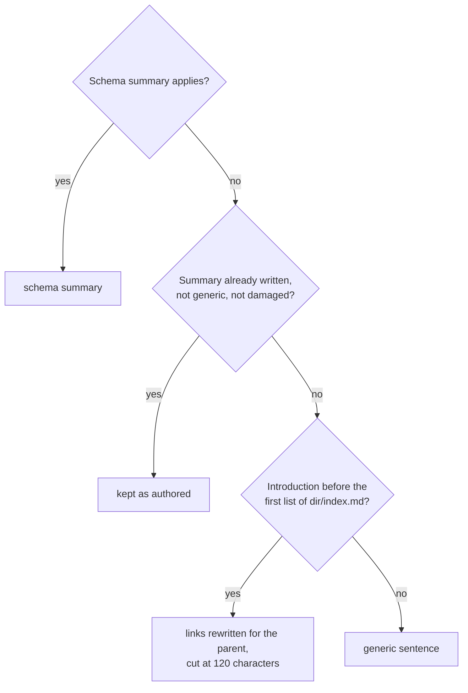

## Description

`okf-schema index` could copy the first list entry of a subdirectory's `index.md` into the
index above it, with a relative link that only works from the subdirectory. `validate` did not
report that broken link, and it reported valid anchored or percent-encoded links as broken.

`index` now writes subdirectory summaries that work from the index holding them and repairs the
damaged ones. `validate` and `stats` share one broken-link check.

```text
api/index.md holds only a list; root index.md after `okf-schema index`

before:  - [api](./api/) — [Health Check](health-check.md)  [API Endpoint]
after:   - [api](./api/) — Auto-generated index for concepts in `api`.
```

Before: the line reported with the defect; the base, `1a742d7`, was not run (see Known gaps).
After: run at `125952d`.

Two more runs at `125952d`: a link to a missing file in the root `index.md`, then the link count
once an anchor-only link and a link to a missing file were added to a concept. `<project>` stands
for the throwaway project folder.

```text
$ okf-schema validate --strict --path kb/bundle
  WARNING [W2] Broken cross-link 'nope.md' in '<project>\kb\bundle\index.md'

$ okf-schema stats --path kb/bundle
  3 links (1 broken)
  Health: 90% — 1 broken link
```

How a subdirectory summary is chosen (a schema summary still comes first):



### Behaviour changes

- A summary is the whole introduction on one line. The 120-character cut never splits a link,
  and falls back to the generic sentence when nothing is left before the link.
- A damaged summary (a leading link that works only from the subdirectory) and the exact generic
  sentence are recomputed. Other summaries are kept as written, a trailing `[...]` included,
  whether the entry links `tables/`, `./tables/` or `./tables`.
- Broken links in every `index.md` and in `log.md` are reported as W2. Bundles holding such
  links get new warnings, so `validate --strict` can start failing until they are fixed.
  `okfkb validate` and `okfreq validate` report these warnings too; `okfreq validate` still
  exits 0 on them.
- W2 and `stats` ignore `#...` anchors (the anchor is not verified) and percent-decode paths
  before checking them. A broken target is reported as written.

### Surfaces

- Runtime: `index_bundle` and `stats_bundle` (`api.py`), `validate_index` and `validate_log`
  (`validator.py`, `validate_log` gets an optional `bundle_root`), and in `_internal/utils.py`
  the new `is_broken_link` and the changed `find_broken_links`, which now relies on it.
- Human documentation: the `index` and `stats` sections of the CLI reference, and W2, the
  validation scope and a compatibility note in the validation codes reference.
- Agent skills: the `index`, `stats` and W2 rows of `skills/okf-schema/SKILL.md`.
- Requirements: scenario S3 of SwRS-OKFSCHEMA-CORE-004 and scenario S4 of
  SwRS-OKFSCHEMA-CORE-001, test markers (`stats` under SwRS-OKFSCHEMA-CORE-005 S1) and a log
  entry. These are marker links and test runs, not stakeholder approval.
- Verification: new API, validator, CLI and utility tests; one fixture `index.md` that held the
  damaged line is fixed.
- Scaffold guidance (`src/okf_schema/data/`): unaffected, it holds no index-generation or W2
  wording.
- Examples: unaffected, no example holds a broken, anchored or encoded link in an index or a log.
- Feature and evidence map: unaffected, it has no row for bundle index generation or W2.
- `index` command help: unaffected, it does not describe summaries.
- `CHANGELOG.md`: the generated unreleased entry for this fix, and the generated entry for the
  `show` fix already on the base branch, which its changelog lacked.

### Example

```sh
okf-schema index --path kb/bundle
okf-schema validate --strict --path kb/bundle
```

### Validation

- `just preflight` on Windows at `125952d`: pass. 1236 tests passed, 12 skipped, 96% total
  coverage; it runs style, lint, requirements lint, changelog, ty, mypy, the examples refresh, the
  requirements report and the Sphinx `-W` docs build.
- The run left no content change in the checkout.
- CI at `125952d`: `preflight` on Python 3.10 to 3.13 and macOS, 1248 tests passed each; Windows,
  1236 passed and 12 skipped. The `tag-release` job was skipped.
- `okfreq validate requirements --prose --check-links --project-root .` at `125952d`:
  36 requirements, 0 errors, 0 warnings.

## Type of Change

- [x] Bug fix
- [ ] New feature
- [ ] Breaking change
- [x] Documentation update
- [ ] Refactoring

## Checklist

- [x] I have run `just preflight` and all checks pass
- [x] I have added tests that prove my fix is effective or my feature works
- [x] I have updated the documentation accordingly
- [ ] My changes generate no new warnings

## Known gaps

- The 12 acceptance tests skip on Windows, `StRS-OKFSCHEMA-CORE-002#S2` among them: they were not
  run locally. The CI Linux and macOS jobs report no skipped test.
- `index` writes concept file names as they are, so a file such as `notes(1).md` now draws W2 on
  the generated `index.md`, which `validate --strict` fails on and `index` cannot fix.
- `index` repairs only a summary that starts with a link. A copied `See [guide](guide.md).` is
  kept and still draws W2; the validation codes reference and the `index` row of the skill word
  this more broadly.
- The `index`, `stats` and `validate` command docstrings carry no `versionchanged` note.
- Seven new private functions have no `Examples` section: five summary helpers in `api.py` and two
  link helpers in `_internal/utils.py`.
- The documentation and the new docstring notes date this change to 0.19.0, while neighbouring
  changes on the base branch say 0.18.2. The number is only right if the release that ships this
  change is 0.19.0; the release has to settle it.
- The log entry under `requirements/` records the `just preflight` run made before this branch was
  moved onto its current base (1187 tests, 95.68% coverage), not the run reported below.
- No before-and-after capture from a run of the base code: a checkout of the base failed on the
  Windows host used (file names too long under `skills-evals/results/`). The "before" behaviour is
  taken from the issue and from the base source.
- Only a line that starts with `<!--` is skipped, so the following lines of a multi-line HTML
  comment enter the subdirectory summary.
- In a linked image `[](b)` only the inner link is matched: the outer link is not
  rewritten, the 120-character cut can split it, and W2 does not check it.
- Backslashes in authored link targets are kept as written.
- A `%00` target, and a target that looks external only once percent-decoded, are reported as
  broken.
- A directory holding only subdirectories gets no `index.md`, so its parent line is the generic
  sentence. A schema with neither `x-okf-summary` nor `description` still writes an empty summary.

## Related Issues

Fixes #57
