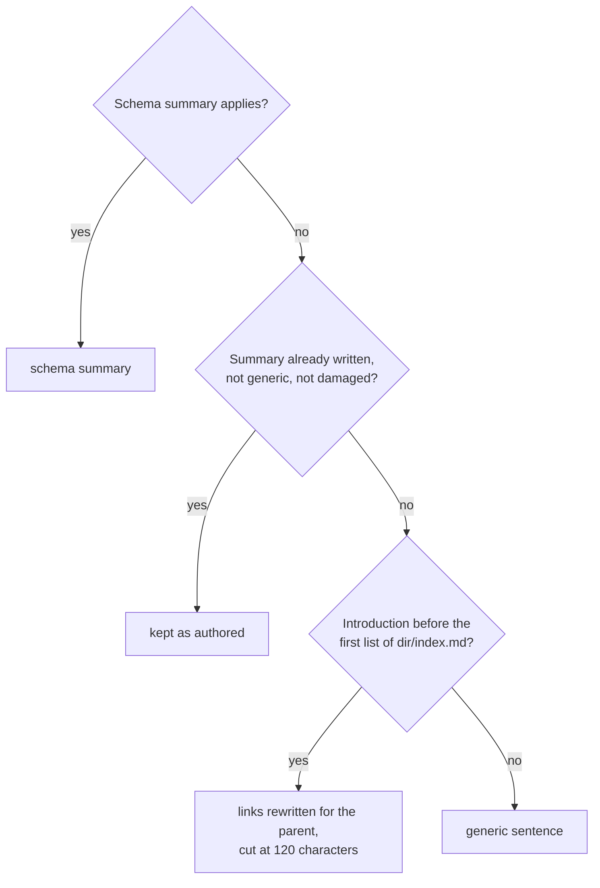

## Description

`okf-schema index` could copy the first list entry of a subdirectory's `index.md` into the
index above it, with a relative link that only works from the subdirectory. `validate` did not
report that broken link, and it reported valid anchored or percent-encoded links as broken.

`index` now writes subdirectory summaries that work from the index holding them and repairs the
damaged ones. `validate` and `stats` share one broken-link check.

```text
api/index.md holds only a list; root index.md after `okf-schema index`

before:  - [api](./api/) — [Health Check](health-check.md)  [API Endpoint]
after:   - [api](./api/) — Auto-generated index for concepts in `api`.
```

How a subdirectory summary is chosen (a schema summary still comes first):



### Behaviour changes

- A summary is the whole introduction on one line. The 120-character cut never splits a link,
  and falls back to the generic sentence when nothing is left before the link.
- A damaged summary (a leading link that works only from the subdirectory) and the exact generic
  sentence are recomputed. Other summaries are kept as written, a trailing `[...]` included,
  whether the entry links `tables/`, `./tables/` or `./tables`.
- Broken links in every `index.md` and in `log.md` are reported as W2. Bundles holding such
  links get new warnings, so `validate --strict` can start failing until they are fixed. This
  also applies to `okfkb validate` and `okfreq validate`.
- W2 and `stats` ignore `#...` anchors (the anchor is not verified) and percent-decode paths
  before checking them. A broken target is reported as written.

### Surfaces

- Runtime: `index_bundle` and `stats_bundle` (`api.py`), `validate_index` and `validate_log`
  (`validator.py`, `validate_log` gets an optional `bundle_root`), the new `is_broken_link` and
  `find_broken_links` (`_internal/utils.py`).
- Human documentation: the `index` and `stats` sections of the CLI reference, and W2, the
  validation scope and a compatibility note in the validation codes reference.
- Agent skills: the `index`, `stats` and W2 rows of `skills/okf-schema/SKILL.md`.
- Requirements: scenario S3 of SwRS-OKFSCHEMA-CORE-004 and scenario S4 of
  SwRS-OKFSCHEMA-CORE-001, test markers (`stats` under SwRS-OKFSCHEMA-CORE-005 S1) and a log
  entry. These are marker links and test runs, not stakeholder approval.
- Verification: new API, validator, CLI and utility tests; one fixture `index.md` that held the
  damaged line is fixed.
- Scaffold guidance (`src/okf_schema/data/`): unaffected, it holds no index-generation or W2
  wording.
- Examples: unaffected, no example holds a broken, anchored or encoded link in an index or a log.
- Feature and evidence map: unaffected, it has no row for bundle index generation or W2.
- `index` command help: unaffected, it does not describe summaries.
- `CHANGELOG.md`: the generated heading of the released 0.18.1 version, unrelated to this change.

### Example

```sh
okf-schema index --path kb/bundle
okf-schema validate --strict --path kb/bundle
```

### Validation

- `just preflight` on Windows, on the reviewed state: pass. 1187 tests passed, 12 skipped,
  coverage 95.68%; style, lint, requirements lint, changelog, ty, mypy, requirements report and
  Sphinx `-W` docs pass.
- `just refresh-all-examples` (run by preflight): no content diff under `examples/`.
- `okfreq validate requirements --prose --check-links --project-root .`: 35 requirements,
  0 errors, 0 warnings.

## Type of Change

- [x] Bug fix
- [ ] New feature
- [ ] Breaking change
- [x] Documentation update
- [ ] Refactoring

## Checklist

- [x] I have run `just preflight` and all checks pass
- [x] I have added tests that prove my fix is effective or my feature works
- [x] I have updated the documentation accordingly
- [ ] My changes generate no new warnings

## Known gaps

- The 12 acceptance tests skip on Windows, `StRS-OKFSCHEMA-CORE-002#S2` among them: they were not
  run locally.
- Only a line that starts with `<!--` is skipped, so the following lines of a multi-line HTML
  comment enter the subdirectory summary.
- In a linked image `[](b)` only the inner link is matched: the outer link is not
  rewritten, the 120-character cut can split it, and W2 does not check it.
- Backslashes in authored link targets are kept as written.
- A `%00` target, and a target that looks external only once percent-decoded, are reported as
  broken.
- A directory holding only subdirectories gets no `index.md`, so its parent line is the generic
  sentence. A schema with neither `x-okf-summary` nor `description` still writes an empty summary.

## Related Issues

Fixes #57
